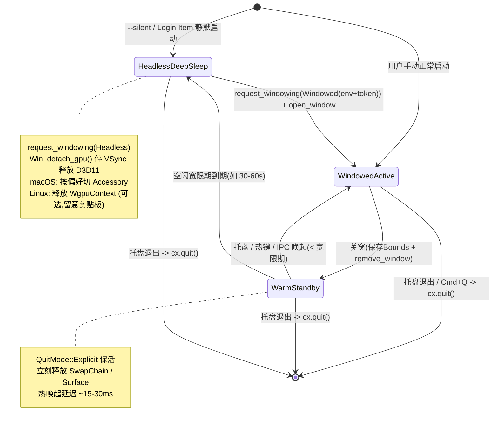
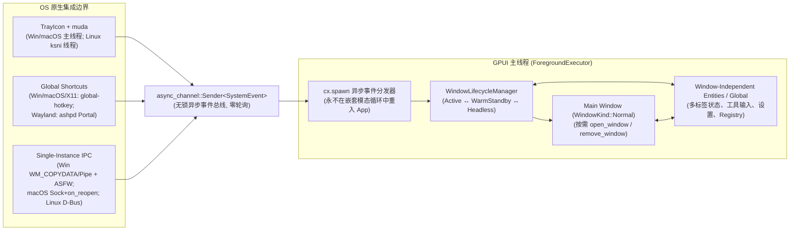

# GPUI 跨平台常驻后台与系统集成方案调研报告

> **关联 Issue**：[`wangneal369/IT-Tools#3`](https://github.com/wangneal369/IT-Tools/issues/3)（归属 Wayfinder 地图 `#1`）  
> **调研日期**：2026-11-26  
> **调研基线（一手源码钉定版本）**：
> - `zed-industries/zed` `main` @ [`bbde02be430d`](https://github.com/zed-industries/zed/commit/bbde02be430d018f2c590671d22f89304be03d8b)（2026-11-26）；同步核对 crates.io `gpui 0.2.2` 与 `gpui-pre 0.3.14`（`zed@f126950`）
> - `tauri-apps/tray-icon` `0.27.0` @ `58976883e84e`（2026-11-25）
> - `tauri-apps/muda` `0.22.0` @ `cad5e30abf04`（2026-11-25）
> - `tauri-apps/global-hotkey` `0.10.0` @ `41b011d42b90`（2026-11-09）
> - `domenkozar/gpui-tray` `0.3.0` @ `04a50d18dae8`（2026-10-21）
> - `iovxw/ksni` `0.3.7`
> - `bilelmoussaoui/ashpd` `0.14.3` @ `83ac1bb8ad7d`（2026-11-21）
> - `1Password/arboard` `3.7.0` @ `538073486463`（2026-11-02）
> - `zzzgydi/auto-launch` `0.6.0` @ `e2feaffbdb6d`（2026-09-17）
> - `WLBF/single-instance` `0.3.3`（最后更新 2021-12-16）与 `tauri-apps/plugins-workspace` (`plugins/single-instance`) @ `9f5f3fcc6e05`（2026-11-26）
> - `kotauskas/interprocess` `2.4.10`（2026-11-25）

---

## 执行摘要（TL;DR）

1. **GPUI 版本分水岭（硬前提）**：crates.io 上旧版 `gpui = "0.2.2"` **缺少**常驻后台核心原语；上游 `zed-industries/zed` `main`（以及社区快照 `gpui-pre 0.3.14`）已将 GPUI 拆分为 `gpui` + `gpui_platform` + `gpui_{windows,macos,linux,wgpu}`，并原生落地了 `QuitMode::Explicit`、`WindowingRequest::{Headless, Windowed}`、`ActivationPolicy::{Regular, Accessory}` 及 `GraphicalEnvironment.activation_token`。**V1 必须锚定 Zed `main`（git rev 锁定）或等价 0.3+ 分发，不可基于旧 `gpui 0.2.2`。**
2. **窗口“关闭即隐藏”的最佳架构不是隐藏原生窗口句柄，而是“销毁窗口 + 保留 App/Entity 状态 + 空闲后切 Headless 卸载 GPU”**：`PlatformWindow` 三端均无单窗 `hide()/show()` API，且 Windows 保留隐藏/最小化窗口存在 **Zed `#66221` 已知 VSync 持续空转 Bug（60Hz ~3.4% 单核 CPU）**。采用 GPUI 官方范式（`crates/gpui/examples/toggle_headless.rs`）在关窗时释放 `Window` 及 GPU Surface/SwapChain，并在空闲宽限期后调用 `request_windowing(WindowingRequest::Headless)`，可同时解决 Windows CPU/VRAM 泄漏、macOS Dock 隐身及 Wayland 重连时合法注入 `XDG_ACTIVATION_TOKEN` 抢焦。
3. **系统托盘无事件循环死锁**：`tray-icon 0.27.0` + `muda 0.22.0` 在 Windows（共享主线程 `GetMessageW`）、macOS（共享主线程 `NSApplication` / `objc2`）可直接运行于 GPUI 主线程；Linux **严禁启用默认 `libappindicator`（GTK3）feature**，必须配置 `default-features = false, features = ["ksni"]`，使用纯 Rust `ksni` + `muda-snapshot` 走独立 D-Bus 线程与 `calloop` 零冲突共存。所有托盘与菜单回调必须经无锁通道异步回到 `AsyncApp`，严禁在嵌套模态菜单循环中重入借用 `App`。
4. **全局快捷键在 Windows / macOS / Linux X11 成熟可用，但在 Linux Wayland 存在硬边界**：`global-hotkey 0.10.0` **完全不支持 Wayland**（且在 XWayland 下会静默连接成功但在原生 Wayland 窗口获焦时完全不触发）。Wayland 必须切至 `ashpd` (`org.freedesktop.portal.GlobalShortcuts`)，需安装合规 `.desktop` 文件，由桌面环境接管绑定与改键 UI（KDE 6+ / GNOME 48+ 可用，GNOME 50+ 完整支持 `activation_token`；Hyprland 需手动配置；Sway/wlroots 缺失原生后端，需提供 CLI `--toggle` 走单实例 IPC 供用户自行绑定系统快捷键兜底）。
5. **单实例、开机自启与剪贴板结论**：
   - **淘汰 `single-instance 0.3.3`**（2021 年起停更且无 IPC 传参/唤醒能力）；推荐参照 `tauri-plugin-single-instance`（Windows `CreateMutexW` + `AllowSetForegroundWindow` + `WM_COPYDATA` 或 `interprocess` Named Pipe；macOS Unix Socket + `Application::on_reopen`；Linux Session D-Bus 透传 `XDG_ACTIVATION_TOKEN`）。
   - **开机自启推荐 `auto-launch 0.6.0`**：Windows（`CurrentUser` Registry + `StartupApproved` 同步）与 Linux（`XdgAutostart`）直接支持 `--silent` 参数；macOS 使用 `SMAppService`（macOS 13+）时**不可传 CLI 参数**，必须通过启动期读取 Apple Event `kAEOpenApplication` 的 `keyAELaunchedAsLogInItem` 识别静默登录启动（或退用 `LaunchAgent` plist）。
   - **剪贴板采用“GPUI 内置为主 + `arboard 3.7.0` 能力补位”**：Windows/macOS/Linux 获焦后读文本/图片可用 GPUI 内置（零重解码开销、兼容 GNOME Wayland）；但涉及 HTML、Windows `CF_DIB` 兼容写图、敏感输出排除剪贴板历史（`exclude_from_history`）以及避开 macOS `gpui_macos` 仅返回首个命中类型坑点时需 `arboard`。**严禁后台静默轮询剪贴板**（规避 macOS 15.4+/26 `NSPasteboard` 隐私弹窗及 GNOME Wayland 无 `ext-data-control` 协议限制），契合 V1“唤起/粘贴时触发 Smart Detection”的定位。

---

## 0. 基线澄清：GPUI 版本与 Crate 架构现状

在调研 `zed-industries/zed` 一手源码时，发现一个极易导致错误架构决策的生态差异：

| 分发渠道 | 版本 | 源码状态 | 后台常驻关键 API 支持情况 |
| :--- | :--- | :--- | :--- |
| crates.io `gpui` | `0.2.2` | 旧版单 crate 架构 | **不支持** `QuitMode`、`WindowingRequest`、`ActivationPolicy`（参见 Zed `#36548` 评论确认） |
| crates.io `gpui-pre` | `0.3.14`（2026-11-23） | 社区按 Zed commit 发布的快照（`zed@f126950`） | 已拆分 `gpui-pre-{windows,macos,linux}`，包含 `QuitMode` 等较新能力 |
| `zed-industries/zed` `main` | `bbde02be430d`（2026-11-26） | 拆分为 `gpui` + `gpui_platform` + `gpui_{windows,macos,linux,wgpu,apple}` | **完整支持** `QuitMode::Explicit`、`with_windowing(WindowingRequest::Headless)`、`App::request_windowing`、`App::set_activation_policy`、`GraphicalEnvironment.activation_token` |

> **来源**：`crates/gpui/Cargo.toml`（注意其 `package.version` 仍写 `0.2.2`，但仓库已演进至多 crate 架构）、`crates/gpui_platform/src/gpui_platform.rs`、crates.io API 实查结果。

后文所有 GPUI 源码路径与行号均指向 `zed-industries/zed@bbde02be430d018f2c590671d22f89304be03d8b`。

---

## 1. 窗口显隐、无窗口保活与后台焦点抢占

### 1.1 关闭拦截与无窗口常驻保活

#### 核心 API 现状
1. **`QuitMode` 退出策略**（由 [PR #42391](https://github.com/zed-industries/zed/pull/42391) 合入，替代未合入的 `#36548`）：
   - 定义于 `crates/gpui/src/app.rs:526-534`：`QuitMode::{Default, LastWindowClosed, Explicit}`。
   - 入口配置：`Application::with_quit_mode(QuitMode::Explicit)`（`app.rs:291`）或运行期 `App::set_quit_mode(QuitMode::Explicit)`（`app.rs:2253`）。
   - 生效位置在窗口移除尾声 `app.rs:3455-3463`：
     ```rust
     let quit_on_empty = match cx.quit_mode {
         QuitMode::Explicit => false,
         QuitMode::LastWindowClosed => true,
         QuitMode::Default => cfg!(not(target_os = "macos")),
     };
     if quit_on_empty && cx.windows.is_empty() {
         cx.quit();
     }
     ```
   - 结论：**设置 `QuitMode::Explicit` 后，三端在关闭全部窗口时均不会调用 `cx.quit()`，主事件循环继续常驻运行**，直到显式调用 `cx.quit()`（如托盘菜单“退出”）。

2. **窗口关闭拦截 `on_window_should_close`**：
   - 公开 API：`Window::on_window_should_close`（`crates/gpui/src/window.rs:7520-7526`）→ `PlatformWindow::on_should_close`（`crates/gpui/src/platform.rs:1372`），回调返回 `bool`（`false` 拦截关闭，`true` 放行销毁）。
   - 三端平台层均已真实接线：
     - **Windows**：`WM_CLOSE` → `handle_close_msg()`（`crates/gpui_windows/src/events.rs:110, 320-324`），返回 `false` 时返回 `Some(0)` 吞掉消息不触发 `DestroyWindow`。
     - **macOS**：`NSWindowDelegate::windowShouldClose:`（`crates/gpui_macos/src/window.rs:475, 3492-3503`），返回 `Bool::NO` 阻止关闭。
     - **Linux X11**：`WM_DELETE_WINDOW` ClientMessage（`crates/gpui_linux/src/linux/x11/client.rs:912-915` → `x11/window.rs:1057-1061`）。
     - **Linux Wayland**：`xdg_toplevel::Event::Close`（`crates/gpui_linux/src/linux/wayland/window.rs:1304-1310` → `wayland/client.rs:1855-1858`）。

3. **无窗口时三端事件循环保活原理**：
   - **Windows**：`WindowsPlatform::new()` 主动创建一个不可见的顶层 `WS_EX_TOOLWINDOW` 平台消息窗（`crates/gpui_windows/src/platform.rs:217-235`），即使业务窗口数为 0，`GetMessageW(&mut msg, None, 0, 0)`（`platform.rs:597`）仍持续阻塞监听 `WM_DISPLAYCHANGE`、`WM_ENDSESSION` 及前台任务分发；仅在 `quit()` 异步 `PostQuitMessage(0)`（`platform.rs:613-617`）时退出。
   - **macOS**：`[NSApplication run]`（`crates/gpui_macos/src/platform.rs:567`）天生支持零窗口常驻；点击 Dock 图标重新激活时触发 `applicationShouldHandleReopen:hasVisibleWindows:`（`platform.rs:1421-1437`），桥接到 `Application::on_reopen`（`app.rs:369`）。
   - **Linux**：`calloop::EventLoop`（`crates/gpui_linux/src/linux/platform.rs:665-688`）持续监听 `main_receiver` 与显示连接 fd，仅在 `quit()` 调用 `common.signal.stop()` 时退出。

4. **Windows 已知关闭竞态风险（务必规避）**：
   - [Zed #66369](https://github.com/zed-industries/zed/issues/66369)（open）：Windows 活跃窗通过原生关闭路径可能引发 `"window not found"` / `"Invalid window handle"` 报错；社区常见规避方式是在 `on_window_should_close` 返回 `false` 后自行调用 `window.remove_window()`。
   - [Zed #66382](https://github.com/zed-industries/zed/issues/66382)（open）：Windows 最后一个窗口移除后偶发主线程阻塞在 `Rc<AppCell>::drop_slow -> Mutex::lock_contended` 导致进程无法退出。对常驻应用而言，真正退出时应先显式清理后台任务与窗口再调用 `cx.quit()`，并在 CI/冒烟测试中验证退出收敛。

---

### 1.2 关键局限：`PlatformWindow` 没有单窗 `hide()` / `show()` API

逐行核查 `PlatformWindow` trait（`crates/gpui/src/platform.rs:1290-1430`）与 `Platform` trait，证实：
- **`PlatformWindow` 仅提供 `minimize()`、`zoom()`、`toggle_fullscreen()`、`activate()`，不存在单窗口级别的 `hide()` 或 `show()`。**
- `App::hide()` → `Platform::hide()` **仅在 macOS 上实现**为 `NSApplication::sharedApplication().hide(None)`（`gpui_macos/src/platform.rs:697-699`，隐藏整个应用全部窗口）；在 **Windows**（`gpui_windows/src/platform.rs:710`）与 **Linux**（`gpui_linux/src/linux/platform.rs:762-764`）均为**空实现（no-op）**。
- `WindowOptions.show = false` 仅用于创建时暂不显示（Windows 延迟写入 `initial_placement`，`gpui_windows/src/window.rs:578-589`），并非运行期显隐切换接口。

#### 两种“关窗隐藏到托盘”实现路线对比

| 维度 | 方案 A：销毁窗口 + 保留 `Entity`/`Global` 状态（+ 可选 Headless 休眠） | 方案 B：`should_close` 返回 `false` + `raw-window-handle` 原生隐藏 |
| :--- | :--- | :--- |
| **实现方式** | 状态全置于 `Global`/`Entity`；关窗时保存 `WindowBounds` 并释放 `Window`；唤起时 `cx.open_window` 重建 View 绑定同一 `Entity` | 拦截 `should_close` 返回 `false`；Win 调 `ShowWindow(hwnd, SW_HIDE)`，macOS 调 `NSWindow::orderOut:`，X11 `unmap_window` |
| **Linux Wayland 兼容性** | **原生完美支持**（Wayland 协议推荐销毁 `xdg_toplevel` 再重建） | **不可行/高危**：Wayland `xdg_toplevel` 无标准“隐藏再原样映射”原语，强行 attach null buffer 破坏 GPUI 内部 `configure`/frame 状态机 |
| **GPU 显存与 CPU 占用** | **立刻释放 SwapChain/Surface**；再切 `Headless` 后 Win VSync 线程彻底停止（详见 §4.4） | **极差**：显存不释放，且 Windows 命中 **Zed `#66221`**（隐藏/最小化窗每帧仍被 `RedrawWindow` 唤醒，耗 ~3% 单核 CPU） |
| **唤起延迟** | 热态（Windowed 零窗重建）：~15–30ms；深休眠（Headless 重连 GPU）：~80–200ms | 极低（~1–5ms） |
| **官方对齐度** | **GPUI 官方标准范式**（见 `crates/gpui/examples/toggle_headless.rs`） | 非官方 hack，易与 GPUI 内部窗口状态机脱节 |

> **明确结论**：V1 应采用 **方案 A（销毁窗口 + 持久化 `Entity` 状态 + 空闲延迟切 Headless）**。由于 IT-Tools 的多标签状态、各工具输入缓冲与搜索索引均可保存在 window-independent 的 `Entity`/`Global` 中，重建 `Window` 仅重新挂载轻量的 GPUI 视图树，用户体验完全等同于“隐藏后秒恢复现场”。

---

### 1.3 三端后台唤起与抢占输入焦点

#### Windows：`SetForegroundWindow` 限制与 GPUI 现状
- **GPUI 现状**：`WindowsPlatform::activate` 为 no-op（`gpui_windows/src/platform.rs:708`），实际聚焦逻辑在 `WindowsWindow::activate()`（`crates/gpui_windows/src/window.rs:815-867`）：
  1. 恢复位置并检测 `IsIconic(hwnd)` → `ShowWindowAsync(hwnd, SW_RESTORE)`；
  2. 调用 `SetActiveWindow(hwnd)` + `SetFocus(Some(hwnd))`；
  3. **内置 `SendInput` 绕过**：模拟按下并抬起 `VK_MENU`（Alt 键，`window.rs:838-860`），紧接着调用 `SetForegroundWindow(hwnd)`（`window.rs:864`）。
- **Microsoft 官方焦点限制**（[Microsoft Learn: `SetForegroundWindow` Remarks](https://learn.microsoft.com/en-us/windows/win32/api/winuser/nf-winuser-setforegroundwindow)）：
  - 仅在满足“当前进程为前景进程 / 前景进程派生 / **接收到最后一次输入事件** / `SPI_GETFOREGROUNDLOCKTIMEOUT` 超时 / 无前景窗”等条件之一时才允许置顶抢焦，否则任务栏闪烁。
- **按唤起路径分析可靠性与坑点**：
  - **全局快捷键唤起（`WM_HOTKEY`）**：系统投递 `WM_HOTKEY` 给注册线程，使应用满足“接收到最后一次输入事件”，`SetForegroundWindow` 通常直接成功。
  - **托盘点击/菜单唤起**：`tray-icon` 弹出菜单前已对隐藏窗调用 `SetForegroundWindow(hwnd)`（`tray-icon/src/platform_impl/windows/mod.rs:586`），本进程已具备前景权限。
  - **二次启动（Single-Instance IPC）唤起**：此时**第二实例（新进程）**拥有前景权限而**第一实例（后台常驻进程）没有**。必须由第二实例在退出前调用 **`AllowSetForegroundWindow(first_pid)`** 移交权限（与 `tauri-plugin-single-instance/src/platform_impl/windows.rs:114-118` 一致），否则第一实例无法稳定置顶。
  - **GPUI `SendInput(VK_MENU)` 副作用警告**：(1) 受 **UIPI** 限制，若当前前景窗以管理员权限运行，普通权限进程的 `SendInput` 会被静默丢弃；(2) 合成 Alt 键偶发激活当前 Win32 前景应用的菜单栏。因此不应依赖该 hack 作为二次启动的唯一手段，必须配合 `AllowSetForegroundWindow`。

#### macOS：`NSApplicationActivationPolicy`、Dock 行为与 Sonoma+ 抢焦
- **ActivationPolicy 与 Dock 图标控制（已合入 Zed `main`）**：
  - 尽管早期独立 PR [#64866](https://github.com/zed-industries/zed/pull/64866) 仍处于 open 状态，但其等价能力已随 `WindowingRequest` 完整合入 `zed-industries/zed@bbde02be430d`：
    - `ActivationPolicy::{Regular, Accessory}`（`crates/gpui/src/platform.rs:166-172`）；
    - `Application::with_windowing(WindowingRequest::Headless)` 在 `[app run]` 之前预先应用 `NSApplicationActivationPolicy::Accessory`（`gpui_macos/src/platform.rs:547-554`），确保静默开机启动时 **Dock 绝不闪烁图标、不出现在 `Cmd+Tab`**；
    - 运行期可通过 `cx.set_activation_policy(ActivationPolicy::Accessory | Regular)`（`app.rs:2265` → `gpui_macos/src/platform.rs:655-666`）或 `cx.request_windowing(...)` 动态切换。
  - **产品策略灵活性**：支持两种 macOS 常见形态且零代码分叉——(a) **纯菜单栏模式**：始终 `Accessory`（文档 `platform.rs:163-164` 明确指出 `Accessory` 仍允许打开窗口并接受输入）；(b) **混合模式**：有窗时切 `Regular`（显示 Dock 与顶部菜单栏，支持 `Cmd+Tab`），关窗后切回 `Accessory` 隐藏 Dock 图标。
- **后台唤起与焦点抢占**：
  - 官方调用序列（见 `crates/gpui/examples/toggle_headless.rs:120-121`）：`cx.activate(true)` + `window.activate_window()`。
  - `gpui_macos/src/platform.rs:649-653` 底层调用 `#[allow(deprecated)] app.activateIgnoringOtherApps(ignoring_other_apps)`；`MacWindow::activate()`（`gpui_macos/src/window.rs:1852-1870`）调用 `window.makeKeyAndOrderFront(None)`。
  - **macOS 14 Sonoma+ 风险提示**：Apple 自 macOS 14 起将 `activateIgnoringOtherApps:` 标记 deprecated，主推协作式 `NSApplication.activate()`；但 `NSApplication.activate()` 在后台热键场景下往往被系统拒绝抢焦。目前 GPUI 继续使用 `activateIgnoringOtherApps(true)` 仍是 Raycast/Alfred/Zed 等原生工具的通用有效手段，但需关注未来 macOS 大版本移除或收紧该 API 的长期风险（必要时可结合 `NSRunningApplication::currentApplication().activateWithOptions(...)` 验证）。

#### Linux（X11 与 Wayland）焦点限制
- **X11**：
  - `X11Window::activate()`（`crates/gpui_linux/src/linux/x11/window.rs:1561-1577`）向根窗口发送 `_NET_ACTIVE_WINDOW` ClientMessage，**注意其时间戳字段传的是 `Time::CURRENT_TIME (0)`**。在严格启用焦点窃取防护（Focus Stealing Prevention）的 WM（如 KWin/Metacity 高级防护）下，缺少有效输入时间戳可能导致窗口仅置顶提示（urgency）而不立即获焦。
  - **已确认踩坑（[Zed #65493](https://github.com/zed-industries/zed/issues/65493)）**：`gpui_linux` X11 后端对所有 `WindowKind::PopUp` 强制设置 `override_redirect = 1`（`x11/window.rs:519`），导致 PopUp 窗口**永远无法接收键盘焦点**。因此主工作台窗口必须使用 `WindowKind::Normal`（即使做无边框自定义标题栏），切勿用 `WindowKind::PopUp`。
- **Wayland**：
  - **协议硬约束**：Wayland 严禁无授权抢焦。`WaylandWindow::activate()`（`crates/gpui_linux/src/linux/wayland/window.rs:1893-1913`）源码明确注释：
    > `// Without a recent press the compositor won't grant focus, but still request a token: KWin and Mutter mark the window as demanding attention`
  - 当进程处于后台无焦点时，`state.client.activation_context()` 无近期输入 serial，直接调 `window.activate_window()` 在 GNOME Mutter / KDE KWin 上**不会抢焦**，仅弹出“窗口已就绪”通知。
  - **关键破局点（GPUI 内置 `activation_token` 通路）**：`GraphicalEnvironment.activation_token`（`crates/gpui/src/platform.rs:239-245`）会在 `request_windowing(WindowingRequest::Windowed(env))` 建立 Wayland 连接时写入 `startup_activation_token`，并由首个打开的窗口自动消费调用 `xdg_activation_v1::activate(token, surface)`（`gpui_linux/src/linux/wayland/client.rs:570, 1137, 1368`）！
    - 只要触发源提供合法的 `XDG_ACTIVATION_TOKEN`（来自：XDG GlobalShortcuts `Activated` 信号选项[GNOME 50+/KDE]、SNI `ProvideXdgActivationToken`、或二次启动进程的环境变量透传），**且主进程处于 `Headless` 态通过 `WindowingRequest::Windowed(env)` 唤起**，即可在 Wayland 上合法秒抢焦点！
    - **现状缺口**：若 GPUI 已处于 `Windowed` 态，目前无公开 API 向已有 `WaylandClient` 注入外部 `activation_token`（需走 `Headless -> Windowed` 路径或向 GPUI 上游提 PR 增加 `PlatformWindow::activate_with_token`）。

---

## 2. 系统托盘（Tray）与 GPUI 事件循环集成

### 2.1 主流方案源码级深度对比

| 维度 | `tray-icon 0.27.0` + `muda 0.22.0`（Tauri 官方） | `gpui-tray 0.3.0`（`domenkozar/gpui-tray`） | 直接使用 `ksni 0.3.7`（仅 Linux） |
| :--- | :--- | :--- | :--- |
| **维护活跃度** | **极高**（Tauri v2 核心依赖，2026-11-25 仍在发版） | 较新社区 crate（2026-10 发版 0.3.0） | 活跃（2026-10 发版 0.3.7），正是 `tray-icon` 的 Linux 后端 |
| **GPUI 版本耦合** | **零耦合**（完全独立于 GPUI 版本升级） | **强耦合**：`Cargo.toml` 锁死特定 `zed` git rev (`8166e3d7`) 或 `gpui-pre 0.3.4` | 零耦合 |
| **Windows 特性** | 完整：`WS_EX_TOOLWINDOW` 隐藏窗、`TaskbarCreated` 重建（Explorer 崩溃恢复）、UIPI 放行、**固定 `NIF_GUID`**（更新后保留“始终显示”状态） | 基础可用：`CreateWindowExW` + `Shell_NotifyIconW`，缺少 `NIF_GUID` 持久化与 `TaskbarCreated` UIPI 放行 | N/A |
| **macOS 特性** | `objc2 0.6` + `NSStatusBar`、支持 template icon、`autosave_name` 位置记忆、左右键分别配置菜单 | `objc2 0.6` + `NSStatusBar`、原生支持 SF Symbols + `gpui::MenuItem` | N/A |
| **Linux 特性** | `default-features = false, features = ["ksni"]`：**纯 Rust D-Bus (`ksni` + `muda-snapshot`)，零 GTK 依赖** | 纯 Rust `zbus 6` 直接实现 SNI + `dbusmenu`，**额外支持 `ProvideXdgActivationToken`**（`backend/linux.rs:531`） | 纯 Rust `zbus` 实现 SNI + `dbusmenu` |
| **菜单体系** | `muda 0.22`（需与 GPUI Action 做一层薄映射） | 直接复用 `gpui::MenuItem` 与 `Action` | 自建 `ksni::MenuItem` |

### 2.2 三端线程模型兼容性与事件循环共存机制（以 `tray-icon 0.27` + `muda 0.22` 为主）

#### Windows（Win32 Message Loop）
- **机制核实**：`TrayIcon::new()`（`tray-icon/src/platform_impl/windows/mod.rs:104-188`）在**调用线程**创建不可见的 `WS_EX_NOACTIVATE | WS_EX_TRANSPARENT | WS_EX_LAYERED | WS_EX_TOOLWINDOW` 窗口并挂接 `muda` 菜单子类。
- **与 GPUI 共存**：`gpui_windows` 的主事件循环是标准 Win32 `GetMessageW(&mut msg, None, 0, 0)`（`gpui_windows/src/platform.rs:597`，`hwnd = None` 表示拉取本线程所有窗口消息）。因此，**只需在 `Application::run(|cx| { ... })` 的主线程回调内构造 `TrayIcon` 和 `muda::Menu`**，GPUI 主循环就会自动驱动托盘图标消息、`TaskbarCreated` 广播及右键菜单！**无需、也不应另开 Win32 消息循环线程**。
- **实操细节**：`TrayIcon` 实例必须存活于整个应用生命周期（可存为 `Global` 或 `Rc<RefCell<...>>` 托管在主线程），`Drop` 时会自动 `NIM_DELETE` 清理图标防止托盘残留“幽灵图标”。

#### macOS（AppKit 主线程）
- **机制核实**：`TrayIcon::new()`（`tray-icon/src/platform_impl/macos/mod.rs:42-60`）强制校验 `MainThreadMarker::new()`，调用 `NSStatusBar::systemStatusBar()` 并使用 `objc2 0.6` / `objc2-app-kit 0.3.2`（与 `gpui_macos` 完全同源）。
- **与 GPUI 共存**：GPUI 在 `did_finish_launching` 之后才调用用户的 `on_finish_launching(cx)` 闭包（`gpui_macos/src/platform.rs:1360-1396`），此时 `NSApplication` 已初始化完毕且位于主线程。在该闭包内创建 `TrayIcon` 即可直接接入主 `NSRunLoop`，零线程模型冲突。

#### Linux（`calloop` vs GTK vs StatusNotifierItem/D-Bus）——**头号避坑点**
- **硬冲突警告（GTK 后端不可用）**：
  - `tray-icon/Cargo.toml:21, 23` 默认开启 `default = ["libappindicator"]`，会引入 `libappindicator 0.10` + `muda/gtk3`（`tray-icon/src/platform_impl/gtk/mod.rs`）。
  - `libappindicator` 强依赖运行中的 **GTK3 主循环（`gtk::main()`）** 才能响应菜单点击和更新，而 GPUI Linux 主线程由 **`calloop::EventLoop`** 独占（`gpui_linux/src/linux/platform.rs:669-676`）。强行在独立线程跑 `gtk::main()` 既引入重量级 C/GTK3 系统依赖（破坏纯 Rust 与 Wayland 兼容性），又容易在 Wayland/X11 多线程初始化时引发段错误或死锁。
- **正确解法（`ksni` + `muda-snapshot` 纯 Rust 后端）**：
  - 配置：
    ```toml
    [target.'cfg(target_os = "linux")'.dependencies]
    tray-icon = { version = "0.27", default-features = false, features = ["ksni"] }
    muda = { version = "0.22", default-features = false, features = ["snapshot"] }
    ```
  - 源码核实（`tray-icon/src/platform_impl/ksni/mod.rs:32-71, 148-163` 及 `menu.rs`）：`ksni` 后端自动在独立后台线程运行 `zbus` + `async-io` D-Bus 服务，另起一条 `tray-icon-menu-watcher` 线程监听 `muda::MenuChangeEvent` 并将 `muda::MenuSnapshotHandle` 转为 `DBusMenu`（`com.canonical.dbusmenu`），点击事件通过无锁 `crossbeam_channel` 发回。**全程零 GTK 依赖、零主循环侵入、与 GPUI `calloop` 100% 安全共存**！
- **Linux 桌面环境硬限制**：
  - **GNOME 原生不内置 StatusNotifierItem 宿主**（用户必须安装 `AppIndicator and KStatusNotifierItem Support` 扩展才可见托盘图标）；KDE Plasma、XFCE、Waybar（Sway/Hyprland/Niri）均原生或通过模块支持。
  - **架构应对**：Linux 上当系统无 SNI Watcher 时，`tray-icon` 的 `ksni` 后端因设置了 `.assume_sni_available(true)`（`ksni/mod.rs:51`）不会导致启动崩溃，但图标不可见；应用应允许配置“无托盘宿主时关窗行为（最小化或退出）”，并提供二次启动 / CLI `--toggle` 唤醒入口兜底。

### 2.3 嵌套模态菜单循环与重入防死锁规范

源码审阅发现一个 Windows 与 macOS 共通的**高危重入陷阱**：
- Windows：`TrackPopupMenu` 在托盘右键菜单弹出期间运行**嵌套 Win32 模态消息循环**（`tray-icon/src/platform_impl/windows/mod.rs:309-310, 583-600`）。
- macOS：`button.performClick(None)` 在弹出 `NSMenu` 期间运行**嵌套 AppKit 事件跟踪循环**（`tray-icon/src/platform_impl/macos/mod.rs:272-284`）。

若在原生事件回调中直接同步借用 GPUI `App`（`AppCell` 为 `RefCell`），一旦嵌套循环重入 GPUI 窗口消息处理就会触发 **`RefCell` 双重可变借用 panic**（`gpui_windows/src/platform.rs:675-679` 与 `gpui_macos/src/platform.rs:582-588` 也反复警示了同类重入问题）。

**安全集成模式（零轮询、零重入）**：
1. 在独立桥接线程（或通过 `TrayIconEvent::set_event_handler` + `MenuEvent::set_event_handler` 回调）将事件无阻塞 `try_send` 到共享 `async_channel::Sender<SystemEvent>`。
2. 在 GPUI 启动时用 `cx.spawn(async move |cx: &mut AsyncApp| { while let Ok(ev) = rx.recv().await { ... } }).detach()` 消费事件——`async_channel` 直接唤醒 GPUI `ForegroundExecutor`（底层经 Win32 `PostMessage` / macOS `DispatchQueue::main` / Linux `calloop` channel），**事件驱动、空闲 0% CPU 占用，且天然在 `AppCell` 未借用的干净栈帧上执行 `cx.update(...)`**。

---

## 3. 全局快捷键（Global Hotkey）与 Wayland 真实边界

### 3.1 `global-hotkey 0.10.0` 三端源码核实

| 平台 | 底层机制（源码出处） | 线程与事件循环要求 | 动态改键 & 冲突检测 | 权限要求与已知坑点 |
| :--- | :--- | :--- | :--- | :--- |
| **Windows** | `RegisterHotKey` / `UnregisterHotKey` + 隐藏 `WS_EX_TOOLWINDOW` 接收 `WM_HOTKEY`（`global-hotkey/src/platform_impl/windows/mod.rs:33-175`） | **主线程创建**，自动共享 GPUI `GetMessageW` 主循环 | 支持 `unregister` + `register` 动态改键；检测 `ERROR_HOTKEY_ALREADY_REGISTERED` | 零特权需求；**坑点**：按下时会派生 50ms 轮询 `GetAsyncKeyState` 线程合成 `Released` 事件（`windows/mod.rs:158-171`），业务层必须只响应 `HotKeyState::Pressed` |
| **macOS** | Carbon `InstallEventHandler(GetApplicationEventTarget())` + `RegisterEventHotKey(..., kEventHotKeyExclusive, ...)`（`macos/mod.rs:44-190`） | **主线程创建**，挂载到 AppKit 主 `CFRunLoop` | 支持动态改键；`kEventHotKeyExclusive` 准确返回 `AlreadyRegistered`（`macos/mod.rs:125-131`） | **普通组合键（Cmd/Opt/Ctrl/Shift+Key）无需 Accessibility 或 Input Monitoring 权限**！仅媒体键走 `CGEventTapCreate` 才需权限（`macos/mod.rs:213`） |
| **Linux X11** | 独立后台线程建 `x11rb::RustConnection`，在 root window 调 `XGrabKey`（自动处理 NumLock/CapsLock 掩码，`x11/mod.rs:30-186, 227-320`） | 独立后台线程，与 GPUI `calloop` 无冲突 | 支持动态改键；捕获 X11 `Access` 错误返回 `AlreadyRegistered` | 已知局限：[issue #198](https://github.com/tauri-apps/global-hotkey/issues/198) 未暴露 X11 事件时间戳（影响严格 WM 的焦点窃取判断） |
| **Linux Wayland** | **完全不支持！** `platform_impl/mod.rs:8-16` 写死编译 `x11/mod.rs`；[issue #28](https://github.com/tauri-apps/global-hotkey/issues/28)、[PR #162](https://github.com/tauri-apps/global-hotkey/pull/162)、[PR #172](https://github.com/tauri-apps/global-hotkey/pull/172) 均仍 open | — | — | **隐蔽陷阱**：在带 XWayland 的 Wayland 会话中，`RustConnection::connect(None)` 会静默连上 XWayland 且 `XGrabKey` 不报错，但焦点在原生 Wayland 窗口时**完全不触发**！ |

### 3.2 Linux Wayland 真实可行性：`ashpd` + XDG Desktop Portal `GlobalShortcuts`

核查 `bilelmoussaoui/ashpd` `0.14.3` 一手源码（`client/src/desktop/global_shortcuts.rs`）及上游 `xdg-desktop-portal` 规范：

1. **核心工作模型（与 Win/macOS 本质不同）**：
   - 应用不可绕过合成器全局抓键，必须经 D-Bus `org.freedesktop.portal.GlobalShortcuts` 与桌面协商：
     1. `GlobalShortcuts::new().await` → `create_session(...)`（`global_shortcuts.rs:239, 265`）；
     2. `bind_shortcuts(&session, &[NewShortcut::new("toggle-window", "Toggle IT-Tools").preferred_trigger("<Ctrl><Alt>t")], ...)`（`global_shortcuts.rs:36-55, 287-302`）——`preferred_trigger` 仅作为建议值，首次绑定会弹出系统确认/设置对话框；
     3. **动态改键**：Wayland 下不能由应用内快捷键录制框直接覆盖绑定，而是调用 Portal v2 的 `configure_shortcuts(&session, window_id, options)`（`global_shortcuts.rs:327-338`）拉起桌面系统的快捷键配置 UI，并订阅 `receive_shortcuts_changed()`（`global_shortcuts.rs:369`）同步实际生效的 `trigger_description()` 到应用设置页显示；
     4. **事件监听与抢焦令牌**：订阅 `receive_activated()`（`global_shortcuts.rs:346`），返回 `Activated(session_handle, shortcut_id, timestamp, options)`，其中 `options` 字典在现代 Portal（`xdg-desktop-portal 1.21+` / GNOME 50+）中携带 **`activation_token`**，可直接传入 §1.3 的 `GraphicalEnvironment.activation_token` 完成 Wayland 合法聚焦！
2. **强制前提条件**：
   - `xdg-desktop-portal 1.21+` 要求非沙盒应用必须提供合规的 reverse-DNS `app_id`（例如 `io.github.wangneal369.it_tools`），且在 `/usr/share/applications/` 或 `~/.local/share/applications/` 存在对应的 `<app_id>.desktop` 文件，否则 Portal 无法识别应用身份并拒绝会话。
3. **主流 Wayland 桌面环境真实支持矩阵**：

| 桌面环境 / 合成器 | Portal 后端 | GlobalShortcuts 状态 | 实际用户交互与限制 |
| :--- | :--- | :--- | :--- |
| **KDE Plasma 6+** | `xdg-desktop-portal-kde` | **完整支持** | 系统设置自带全局快捷键管理 UI，支持 `BindShortcuts` / `ConfigureShortcuts` |
| **GNOME 48+ (Mutter)** | `xdg-desktop-portal-gnome` | **支持（GNOME 50+ 完整）** | GNOME 48 起支持 Portal 绑定；GNOME 50+ 在 `Activated` 信号中完整回传 `activation_token` 解决唤醒抢焦 |
| **Hyprland** | `xdg-desktop-portal-hyprland` | **半支持** | 仅注册槽位不弹窗，用户需在 `hyprland.conf` 手动绑定 `bind = ..., global, <app_id>:<shortcut_id>` |
| **Sway / 通用 wlroots** | `xdg-desktop-portal-wlr` | **不支持** | 无原生 `GlobalShortcuts` 实现；**必须提供降级兜底**：应用支持命令行 `it-tools --toggle`（经单实例 IPC 秒唤主窗），由用户在 Sway/DE 配置中绑定系统快捷键调用该命令 |

### 3.3 推荐跨平台热键抽象

- 运行期在 Linux 检测 `std::env::var_os("WAYLAND_DISPLAY").is_some()`：
  - **Windows / macOS / Linux X11**：使用 `global-hotkey 0.10.0`，主线程（Win/macOS）或后台线程（X11）注册，`GlobalHotKeyEvent::set_event_handler` 过滤 `HotKeyState::Pressed` 后转发至 `async_channel::Sender<SystemEvent>`，应用内支持直接录键并动态 `unregister` + `register`。
  - **Linux Wayland**：优先异步连接 `ashpd::desktop::global_shortcuts::GlobalShortcuts`（绑定失败或 Portal 不可用时不报错崩溃），设置页针对 Wayland 显示“调用系统快捷键配置（`ConfigureShortcuts`）”按钮，并明示 `--toggle` 命令兜底说明。

---

## 4. 单实例防重、开机自启、剪贴板读取与隐藏态资源释放

### 4.1 单实例防重与二次启动唤醒

#### 为什么必须淘汰 `single-instance 0.3.3`
审阅 `WLBF/single-instance/src/lib.rs`（crates.io `0.3.3`，最后更新 **2021-12-16**）源码证实：
1. **停止维护且依赖陈旧**：仍依赖已归档的 `winapi` 而非 `windows-sys` / `windows`。
2. **仅做布尔互斥，无任何 IPC 通道**：Windows 仅调用 `CreateMutexW` 检测 `ERROR_ALREADY_EXISTS`（`lib.rs:58-76`），Linux 仅 `bind` 抽象 Unix socket 不 `listen`/`accept`（`lib.rs:109-127`），macOS 仅对文件加 `flock`（`lib.rs:161-176`）。**完全无法通知首实例“唤醒窗口”或传递 `--toggle` / 目标工具参数**。

#### 推荐的跨平台单实例 + 唤醒方案

对比 `tauri-apps/plugins-workspace`（`plugins/single-instance`）生产源码与 `interprocess 2.4.10`（2026-11-25 活跃维护）：

| 平台 | 方案 1：平台原生最优（对齐 `tauri-plugin-single-instance`） | 方案 2：统一 `interprocess 2.4.10` LocalSocket | 关键避坑要点 |
| :--- | :--- | :--- | :--- |
| **Windows** | `CreateMutexW` + 隐藏窗 `FindWindowW`（40×25ms 重试防双击竞态）+ **`AllowSetForegroundWindow(pid)`** + `SendMessageTimeoutW(WM_COPYDATA)`（`windows.rs:92-153`） | Named Pipe（`\\.\pipe\<app-id>-<user>`）服务端/客户端 + **首次握手由首实例回传 PID，第二实例调用 `AllowSetForegroundWindow(pid)`** | **必须调用 `AllowSetForegroundWindow(first_pid)`**，否则 Windows 拒绝后台首实例抢焦；Mutex/Pipe 名称须包含当前用户隔离标识以兼容多用户/RDP |
| **macOS** | Unix Domain Socket（置于 `$TMPDIR` 或 `/tmp/<id>_si.sock`，路径长度 `< 104` 字节限制；`macos.rs:63-136`）+ `Application::on_reopen` | 同左（`interprocess` 封装 `UnixListener`/`UnixStream`），需处理进程崩溃遗留的 stale socket（先 `connect`，`ConnectionRefused` 时 `remove_file` 再 `bind`） | macOS 通过 Finder/Dock 重复点击 `.app` 不会启动第二个进程，而是直接触发 `NSApplicationDelegate::applicationShouldHandleReopen:`，由 GPUI `Application::on_reopen` 承接；Unix Socket 用于终端/CLI `--toggle` 场景 |
| **Linux** | **Session D-Bus well-known name**（`zbus`，如 `io.github.wangneal369.it_tools.SingleInstance`，`linux.rs:49-118`）：内核级进程退出自动释放名称，彻底杜绝 stale socket 问题，且可携带 `argv` + **`XDG_ACTIVATION_TOKEN`** | `$XDG_RUNTIME_DIR/<app-id>.sock`（权限 `0600`，避免 Linux abstract socket 跨权限风险），同样在载荷中携带 `argv` + `XDG_ACTIVATION_TOKEN` | **务必从第二实例环境中提取 `XDG_ACTIVATION_TOKEN` 一并发送给首实例**，使 Wayland 桌面点击应用启动器二次唤起时也能合法抢焦 |

> **建议**：Windows 与 macOS 采用轻量自封装模块（约 150 行，参考 `tauri-plugin-single-instance` 模式或 `interprocess 2.4.10` + Windows `AllowSetForegroundWindow` 补丁）；Linux 因 `ksni`/`ashpd` 已引入 `zbus`，直接使用 **Session D-Bus**（无 D-Bus 会话时回退 `$XDG_RUNTIME_DIR` Unix Socket）零额外依赖且最健壮。

---

### 4.2 开机自启（含静默启动到托盘）

核查 `zzzgydi/auto-launch` `0.6.0`（`@e2feaffb`）三端源码：

| 平台 | `auto-launch 0.6.0` 实现机制 | 是否支持传参（如 `--silent`） | 关键坑点与静默启动落地方案 |
| :--- | :--- | :--- | :--- |
| **Windows** | `windows.rs:5-96`：写 `HKCU\...\CurrentVersion\Run`（推荐 `WindowsEnableMode::CurrentUser`，免 UAC），并读写 `Explorer\StartupApproved\Run` 同步任务管理器启用/禁用状态 | **原生完整支持**（`windows_command_line.rs` 负责 Win32 参数转义） | 直接注册 `args: &["--silent"]`；应用解析到 `--silent` 时以 `WindowingRequest::Headless` + `QuitMode::Explicit` 启动，不创建主窗，仅初始化托盘与热键 |
| **macOS** | `macos.rs:98-161`：支持 `SMAppService`（macOS 13+ 官方推荐，包装 `smappservice-rs`）、`LaunchAgent`（`~/Library/LaunchAgents/<name>.plist`）、`AppleScript`（触发 Automation 隐私弹窗，不推荐） | **`SMAppService` 不支持传 CLI 参数！**（`macos.rs:43-44, 99-105`）；`LaunchAgent` 的 `ProgramArguments` 支持传参 | **一等方案（签名 `.app` bundle）**：用 `SMAppService` 注册，启动时在 `Application::run` 早期检查当前 Apple Event `NSAppleEventManager.shared.currentAppleEvent` 的 `eventID == kAEOpenApplication` 且 `keyAEPropData == keyAELaunchedAsLogInItem`，命中即判定登录自启并保持 `ActivationPolicy::Accessory` 不开窗。<br>**备选/开发态方案**：`LaunchAgent` plist 传入 `--silent`（需填 `AssociatedBundleIdentifiers` 避免系统设置中显示开发者不明的“后台项目”） |
| **Linux** | `linux.rs:37-66, 217-262`：`LinuxLaunchMode::XdgAutostart` 写 `~/.config/autostart/<app>.desktop`（含完整 XDG Exec 转义、`StartupNotify=false`）；另支持 `Systemd` 模式 | **原生完整支持** | **必须选用 `XdgAutostart`**（`Systemd` 模式挂在 `default.target`，早于 `graphical-session.target` 导致无 `DISPLAY`/`WAYLAND_DISPLAY` 且无托盘宿主），传 `--silent` 参数 |

---

### 4.3 剪贴板读取：`gpui` 内置 `Clipboard` vs `arboard 3.7.0`

逐行比对 `gpui_windows/src/clipboard.rs`、`gpui_macos/src/pasteboard.rs`、`gpui_linux/src/linux/{x11,wayland}/clipboard.rs` 与 `1Password/arboard@53807348` 一手源码：

#### 能力与行为差异矩阵

| 能力维度 | `gpui` 内置 `Clipboard` | `arboard 3.7.0` | 对 IT-Tools 的工程影响 |
| :--- | :--- | :--- | :--- |
| **纯文本读/写** | 三端完整支持（统一规范为 `\n`），支持内部 JSON metadata | 三端完整支持 | 两者均满足核心文本工具 |
| **图片读/写** | 保留**原始压缩字节**（PNG/JPEG/SVG/GIF/WebP/BMP 等，零解码开销）。**缺陷**：<br>1. Wayland `send()` 仅写文本不写图片（`wayland/clipboard.rs:177-181`）；<br>2. Windows 写图不写 `CF_DIB`（`windows/clipboard.rs:201-221`）；<br>3. **macOS `read()` 按“文件→文本→图片”短路返回首个命中**（`pasteboard.rs:59-111`），剪贴板同时含文本和图片时丢失图片！ | 统一解码/编码为未压缩 RGBA `ImageData`（写图：Win 写 `CF_DIB`，macOS 写 `NSImage`，Linux 写 `image/png`）；按格式显式请求 `get_text()` / `get_image()` / `get_html()` / `get_file_list()`，无短路吞图问题 | 读大图片做预览/识别时 `gpui` 零解码更快；但**跨应用写图（Win/Wayland）及多格式并存读图（macOS）** `arboard` 更完整 |
| **HTML / 文件列表** | **不支持 HTML**；文件列表（`ExternalPaths`）仅 Win (`CF_HDROP`) 与 macOS (`NSFilenamesPboardType`) 可读，X11 `URI_LIST` 被注释（`x11/clipboard.rs:81`），Wayland 读不支持 | 三端完整支持 `get_html`/`set_html` 及 `get_file_list`/`set_file_list`（含 Linux `text/uri-list` & `x-special/gnome-copied-files`） | Smart Detection 若需识别富文本 HTML 片段或 Linux 文件路径，需 `arboard` 补位 |
| **隐私/敏感排除标记** | **不支持** | **原生支持**：Win (`exclude_from_clipboard_history` / `exclude_from_cloud` / `exclude_from_monitoring`)、macOS (`exclude_from_history`)、Linux KDE (`x-kde-passwordManagerHint`) | **高价值特性**：密码/密钥/JWT 生成器的一键复制可标记不入系统剪贴板历史 |
| **Windows 占用容错** | `OpenClipboard(None)` 单次调用无重试（`windows/clipboard.rs:348-356`），被剪贴板工具短暂锁定时直接返回 `None` | 基于 `clipboard-win 5.3.1` 内置重试退避 | 明显降低 Windows 偶发读取失败率 |
| **Linux Wayland 后台读取** | 走标准 `wl_data_device`，**仅在 GPUI 窗口拥有键盘焦点时**才收到 `WlDataOffer`（后台读返回 `None` 或陈旧缓存 `cached_read`） | 开启 `wayland-data-control` feature 后走 `wl-clipboard-rs`（`ext-data-control-v1` / `zwlr-data-control-v1`），在 **KDE KWin / Sway / Hyprland** 支持无焦点后台读取；**但在 GNOME Mutter 上彻底不可用**（Mutter 拒绝实现 data-control 协议） | **窗口获焦后再触发 Smart Detection** 是唯一三端+GNOME Wayland 全通的时机 |

#### 权限、隐私提示与性能边界
1. **macOS 15.4+ / macOS 26 剪贴板隐私提示**：
   - Apple 已在 macOS 引入类似 iOS 的 `NSPasteboard` 隐私防护（`NSPasteboard.accessBehavior`：`default` / `ask` / `alwaysAllow` / `alwaysDeny`）。**任何非用户粘贴手势触发的程序化剪贴板读取，在默认模式下都会弹出系统同意弹窗**；仅使用 `detect` 类 API 探测是否存在某种类型不触发弹窗。
   - **产品与架构对策**：
     - 严格遵守地图 `#1` 的“不做后台剪贴板历史监听”约束，**禁止后台轮询剪贴板**；
     - 唤起窗口后的 Smart Detection 默认提供明确开关（“唤起时自动检测剪贴板”）；在 macOS 上引导用户首次授权“始终允许（Always Allow）”，或在关闭自动检测时仅在用户按下 `Cmd+V` 时读取，做到零骚扰弹窗。
2. **性能边界与大负载防护**：
   - 剪贴板可能包含数十 MB 日志文本或 4K 未压缩位图（RGBA ~33MB）。
   - Smart Detection 严禁在 UI 主线程同步解码整张大图或对超大文本跑全量正则/JSON 解析：应先做快速字节长度截断（例如仅取前 64 KB 做特征嗅探，超过阈值如 2 MB 仅提示“检测到大型文本剪贴板，点击导入”而非自动解析），解码图片放至 `BackgroundExecutor`。

---

### 4.4 隐藏状态下 GPUI GPU Surface 与内存释放机制

基于 `gpui_windows`、`gpui_macos`、`gpui_linux`、`gpui_wgpu` 一手源码及 Zed 实测 Issue，GPUI 在三种后台驻留状态下的资源开销差异悬殊：

| 后台驻留状态 | Windows (`DirectX 11` + `DirectComposition`) | macOS (`Metal` / `CAMetalLayer`) | Linux (`wgpu` / Vulkan / GLES) | 综合评价 |
| :--- | :--- | :--- | :--- | :--- |
| **状态 1：窗口最小化 / 原生句柄隐藏**（Window 仍存活） | **严重缺陷（[Zed #66221](https://github.com/zed-industries/zed/issues/66221)）**：`VSyncProvider` 线程（`gpui_windows/src/platform.rs:469-496`）即使发现窗口不可见，仍每帧调用 `RedrawWindow(RDW_INVALIDATE)`，导致 60Hz 空转 **~3.4% 单核 CPU**（240Hz 更高），且 `IDXGISwapChain1` + RenderTarget + Atlas 全量占显存 | `window_did_change_occlusion_state`（`gpui_macos/src/window.rs:3254-3266`）自动 `stop_display_link()`，CPU 归零；但 `CAMetalLayer` / 纹理图集显存仍常驻 | **X11 已知 Bug（[Zed #64388](https://github.com/zed-industries/zed/issues/64388)）**：GNOME X11 最小化窗仍误报 `Visible` 持续请求帧；Wayland 合成器不发 frame callback CPU 低，但 `wgpu::Surface` 显存常驻 | **不可接受**（Windows 与 X11 均存在后台空转耗电问题） |
| **状态 2：关闭销毁窗口，保留 Windowed 平台上下文**（`remove_window()` + `QuitMode::Explicit`） | `WindowsWindow::drop`（`window.rs:611-632`）销毁 `HWND` 并 Drop `DirectXRenderer`（释放 `IDXGISwapChain1`、`ID3D11Texture2D`、`DirectComposition`）；`all_windows` 为空不再发 `RedrawWindow`。但 `VSyncProvider` 线程仍在 `wait_for_vsync()` 空循环，共享 `DirectXDevices` 保留 | `MacWindow::drop`（`window.rs:1456-1494`）显式释放 `accesskit_adapter`（打破循环引用）、调 `renderer.destroy()`、停 `DisplayLink`、释放 `NSWindow` 与 `CAMetalLayer`——**窗口级 CPU/VRAM 已彻底清零** | `X11Window::drop`（`x11/window.rs:888-916`）与 `WaylandWindow::drop`（`wayland/window.rs:775-808`）均调用 `state.renderer.take()`，释放 `WgpuRenderer` 与 `wgpu::Surface`（`wgpu_renderer.rs:2149-2153`） | **热待机优选**：重开窗口仅 ~15–30ms，释放全部窗口级 Surface/SwapChain |
| **状态 3：零窗口后切 `WindowingRequest::Headless`**（深休眠） | `request_windowing(Headless)` 调用 **`detach_gpu()`**（`gpui_windows/src/platform.rs:423-430`）：**彻底停止 `VSyncProvider` 线程并释放 `DirectXDevices`**，后台 CPU ≈ **0%**，GPU 显存 ≈ **0 MB** | 切换 `ActivationPolicy::Accessory`（隐藏 Dock 图标与菜单栏） | `replace_connection(DisplayConnection::Headless)`（`gpui_linux/src/linux/platform.rs:489-491`）：断开显示连接并释放共享 `WgpuContext`；**附带收益**：下次重连可合法注入 Wayland `XDG_ACTIVATION_TOKEN` | **深休眠最优**：彻底消除 Windows VSync 线程与全部 GPU 设备上下文占用；重连耗时 ~80–200ms |

#### 推荐的“两阶段后台休眠状态机”



> **Linux 切 Headless 的剪贴板注意**：在 Linux X11/Wayland 上，若用户刚在 IT-Tools 内复制了结果并立即关窗，过早断开显示连接会丢失该进程托管的剪贴板所有权（虽 `gpui_linux` 在 X11 退出时会等待剪贴板移交 `wait_for_clipboard_handovers`，但切 Headless 后若无剪贴板管理器接管仍可能失效）。30–60s 的 `WarmStandby` 宽限期（或检测到本进程当前不持有选区时才切 `Headless`）能兼顾极速热唤起与剪贴板可用性。

---

## 5. 推荐集成架构与 Crate 选型总结

### 5.1 推荐 Crate 组合

| 能力模块 | Windows（一等） | macOS（一等） | Linux（核心可用） |
| :--- | :--- | :--- | :--- |
| **UI & 平台运行时** | `gpui` + `gpui_platform`（锚定 Zed `main` rev 或 `gpui-pre >= 0.3.14`，支持 `QuitMode::Explicit` + `WindowingRequest` + `ActivationPolicy`） | 同左 | 同左（需用 `gpui_platform::linux(WindowingModes::all())`） |
| **系统托盘 + 菜单** | `tray-icon 0.27` + `muda 0.22`（主线程初始化，配置固定 `GUID`） | `tray-icon 0.27` + `muda 0.22`（主线程初始化，Template icon + `autosave_name`） | `tray-icon 0.27`（`default-features = false, features = ["ksni"]`）+ `muda 0.22`（`features = ["snapshot"]`） |
| **全局快捷键** | `global-hotkey 0.10`（主线程，仅响应 `Pressed`） | `global-hotkey 0.10`（主线程，Carbon 无 TCC 权限弹窗） | **X11**：`global-hotkey 0.10`；**Wayland**：`ashpd 0.14` (`GlobalShortcuts`) + `--toggle` CLI 兜底 |
| **单实例 + 唤醒 IPC** | `CreateMutexW` + `AllowSetForegroundWindow(pid)` + `WM_COPYDATA`（或 `interprocess 2.4` + `AllowSetForegroundWindow`） | Unix Domain Socket（`$TMPDIR`）+ GPUI `Application::on_reopen` | Session D-Bus（`zbus`，透传 `XDG_ACTIVATION_TOKEN`），无 D-Bus 回退 `$XDG_RUNTIME_DIR` Socket |
| **开机自启** | `auto-launch 0.6`（`WindowsEnableMode::CurrentUser`，带 `--silent`） | `auto-launch 0.6`（`SMAppService` + Apple Event `keyAELaunchedAsLogInItem` 检测；非打包态备选 `LaunchAgent`） | `auto-launch 0.6`（`LinuxLaunchMode::XdgAutostart`，带 `--silent`） |
| **剪贴板读取与隐私写** | 主读用 `arboard 3.7`（带重试、HTML/文件/图片不短路）或 `gpui`（大压缩图零解码）；敏感写入必用 `arboard` `exclude_from_clipboard_history` | 窗口获焦后触发；用 `arboard 3.7`（避免 `gpui` 文本吞图短路 + 支持 `exclude_from_history`），尊重 macOS 15.4+/26 隐私策略 | **获焦后优先用 `gpui` 内置读取（唯一兼容 GNOME Wayland）**；HTML/文件列表及 KDE 隐私写按需辅以 `arboard 3.7`（`wayland-data-control`） |

### 5.2 统一事件桥接架构



---

## 6. 已确认的平台硬限制与需纳入地图的新风险

1. **GPUI 版本锚定风险**：crates.io `gpui 0.2.2` **不具备**常驻后台所需核心 API，项目必须直接依赖 `zed-industries/zed` 固定 git rev（或 `gpui-pre 0.3.14+`），需在依赖管理与构建基线（地图未决项）中规划版本升级节奏与 MSRV（`tray-icon 0.27` 要求 `rust-version = "1.92"`）。
2. **Linux Wayland 全局热键与聚焦碎片化（硬边界）**：
   - `global-hotkey` 在 Wayland 不可用；`xdg-desktop-portal GlobalShortcuts` 在 KDE 6+ / GNOME 48+ 可用（GNOME 50+ 完整抢焦），但在 Hyprland 需手动配置、在 Sway/wlroots 缺失后端；
   - Linux 打包分发必须交付标准 reverse-DNS `.desktop` 文件（既是 Portal 认证硬前提，也决定托盘/任务栏图标匹配）；
   - 原生未装 AppIndicator 扩展的 GNOME 无托盘显示区。
3. **macOS 15.4+ / 26 剪贴板隐私与 Sonoma+ 激活策略收紧**：
   - 自动剪贴板 Smart Detection 在 macOS 新系统上会触发一次用户授权弹窗，产品规格必须将其设计为**显式可配置开关**并保留零弹窗的手动 `Cmd+V` 降级路径；
   - `gpui_macos` 仍使用已废弃的 `activateIgnoringOtherApps(true)`，需在真机 macOS 14/15/26 纳入发版回归清单。
4. **Windows 上游已知缺陷与防护**：
   - 切勿使用“最小化/隐藏活窗口”模式，避免踩中 [Zed #66221](https://github.com/zed-industries/zed/issues/66221) VSync 持续空转；
   - 关注 [Zed #66369](https://github.com/zed-industries/zed/issues/66369) / [#66382](https://github.com/zed-industries/zed/issues/66382) 窗口销毁与退出竞态，并在原型阶段（`wayfinder:prototype`）针对“反复关窗→热键唤起→切 Headless→二次启动唤醒→退出”做高频压力验证。
5. **X11 `WindowKind::PopUp` 不可获焦（[Zed #65493](https://github.com/zed-industries/zed/issues/65493)）**：主工作台与快速命令面板应托管于 `WindowKind::Normal` 窗口内，避免使用独立 `PopUp` 窗口承载输入框。

---

## 7. 一手参考来源索引

- **GPUI 核心与平台源码**（`zed-industries/zed@bbde02be430d018f2c590671d22f89304be03d8b`）：
  - `crates/gpui/src/app.rs`（L289-305, L369-380, L525-534, L1374-1411, L2253-2267, L3455-3463）
  - `crates/gpui/src/platform.rs`（L165-172, L226-355, L1290-1430, L3200-3360）
  - `crates/gpui/examples/toggle_headless.rs`、`crates/gpui/examples/on_window_close_quit.rs`
  - `crates/gpui_windows/src/{platform.rs, window.rs, events.rs, clipboard.rs, directx_renderer.rs}`
  - `crates/gpui_macos/src/{platform.rs, window.rs, pasteboard.rs}`
  - `crates/gpui_linux/src/linux/{platform.rs, x11/{client.rs, window.rs, clipboard.rs}, wayland/{client.rs, window.rs, clipboard.rs}}`
  - `crates/gpui_wgpu/src/{wgpu_renderer.rs, wgpu_atlas.rs}`
- **Zed 关键 Issues & PRs**：
  - [PR #42391](https://github.com/zed-industries/zed/pull/42391)（`QuitMode` 已合入）、[PR #36548](https://github.com/zed-industries/zed/pull/36548)（历史讨论）、[PR #64866](https://github.com/zed-industries/zed/pull/64866)（macOS ActivationPolicy）
  - [Issue #66221](https://github.com/zed-industries/zed/issues/66221)（Windows 最小化窗口 VSync 空转）、[Issue #64388](https://github.com/zed-industries/zed/issues/64388)（X11 最小化窗口帧请求）
  - [Issue #66369](https://github.com/zed-industries/zed/issues/66369) / [Issue #66382](https://github.com/zed-industries/zed/issues/66382)（Windows 关窗与退出竞态）、[Issue #65493](https://github.com/zed-industries/zed/issues/65493)（X11 `WindowKind::PopUp` 无法获焦）
- **Rust 系统集成 Crates 一手源码**：
  - `tauri-apps/tray-icon@58976883`（`0.27.0`）：`Cargo.toml`、`src/platform_impl/{windows,macos,ksni,gtk}/mod.rs`、`ksni/menu.rs`
  - `tauri-apps/muda@cad5e30a`（`0.22.0`）
  - `domenkozar/gpui-tray@04a50d18`（`0.3.0`）：`Cargo.toml`、`src/backend/{windows,macos,linux}.rs`
  - `tauri-apps/global-hotkey@41b011d4`（`0.10.0`）：`src/platform_impl/{mod,windows/mod,macos/mod,x11/mod}.rs`；Issues [#28](https://github.com/tauri-apps/global-hotkey/issues/28)、[#162](https://github.com/tauri-apps/global-hotkey/pull/162)、[#172](https://github.com/tauri-apps/global-hotkey/pull/172)、[#198](https://github.com/tauri-apps/global-hotkey/issues/198)
  - `bilelmoussaoui/ashpd@83ac1bb8`（`0.14.3`）：`client/src/desktop/global_shortcuts.rs`
  - `WLBF/single-instance`（`0.3.3`）：`src/lib.rs`
  - `tauri-apps/plugins-workspace@9f5f3fcc`：`plugins/single-instance/src/platform_impl/{windows,macos,linux}.rs`
  - `zzzgydi/auto-launch@e2feaffb`（`0.6.0`）：`src/{windows,macos,linux}.rs`
  - `1Password/arboard@53807348`（`3.7.0`）：`Cargo.toml`、`src/lib.rs`、`src/platform/{windows,osx,linux/wayland}.rs`
- **操作系统官方文档**：
  - Microsoft Learn：`SetForegroundWindow`、`AllowSetForegroundWindow`、`RegisterHotKey`
  - Apple Developer Documentation：`NSApplication.ActivationPolicy`、`NSApplication.activate()` / `activateIgnoringOtherApps:`、`SMAppService.mainApp`、`NSPasteboard.accessBehavior`
  - XDG Desktop Portal：`org.freedesktop.portal.GlobalShortcuts`
