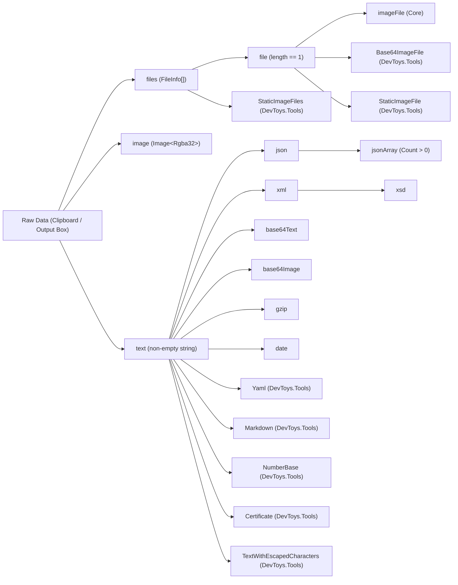

# IT-Tools 与 DevToys 工具目录、智能识别与工作台交互调研报告

> 对应 Issue：[wangneal369/IT-Tools#4](https://github.com/wangneal369/IT-Tools/issues/4)（Wayfinder 地图 [#1](https://github.com/wangneal369/IT-Tools/issues/1)）
> 调研基线：全部结论均直接核查自上游一手源码与官方文档（禁止二手转述或记忆估算），并锁定到具体 commit SHA。

## 0. 一手源码基线与仓库结构查证

| 上游仓库 | 核查分支 / Tag | 锁定 Commit SHA | 角色与架构说明 |
| :--- | :--- | :--- | :--- |
| [`CorentinTh/it-tools`](https://github.com/CorentinTh/it-tools) | `main` | `d505845f918e946ec300af7b36efc107e2f66e9e` | Vue 3 + Naive UI 单页 Web 应用；全部 **86** 个工具集中注册在 [`src/tools/index.ts`](https://github.com/CorentinTh/it-tools/blob/d505845f918e946ec300af7b36efc107e2f66e9e/src/tools/index.ts)（无未注册遗留目录）。 |
| [`DevToys-app/DevToys`](https://github.com/DevToys-app/DevToys) | `main`（最新 Release `v2.0.9.0`） | `2dbbc8aa594978d11165a0e8112243c96a277dbc` | DevToys 2.0 跨平台宿主机壳（.NET + Blazor Hybrid + OS 原生 WebView2/WebKit），包含 `DevToys.Api`、`DevToys.Core`、`DevToys.Business`、`DevToys.Blazor`（含 **3** 个内置系统页与 **13** 个核心数据类型探测器）及 Windows/macOS/Linux/CLI 宿主。 |
| [`DevToys-app/DevToys.Tools`](https://github.com/DevToys-app/DevToys.Tools) | `main` | `de655a558b1d0e32a2ee8df2cb2a02eefe0b46e0` | **重要架构事实**：DevToys 2.0 将全部 **30** 个默认内置开发工具拆分到了独立官方扩展仓库 `DevToys.Tools` 中（随安装包预置，通过 MEF 加载）；其中 **26** 个工具同时实现 `ICommandLineTool`，并附带 **8** 个工具侧数据类型探测器。另有 PNG/JPEG 压缩器独立拆出为 [`DevToys-app/DevToys.PngCompressor`](https://github.com/DevToys-app/DevToys.PngCompressor)。 |
| [`DevToys-app/DevToys`](https://github.com/DevToys-app/DevToys/tree/1.0.14.0) | `1.0.14.0` | `3ad0ff2d96f93db167a2c2a0b3b669db389a248a` | DevToys 1.0（Windows UWP）基线：共 **29** 个开发工具、6 个分组，用于交叉核验 1.0 → 2.0 的演进取舍。 |
| [`DevToys-app/Documentation`](https://github.com/DevToys-app/Documentation) | `main` | `a972df253e48f24172658d5bb34b4a1889e4600e` | 官方扩展开发文档与 UX 指南（含 [`support-smart-detection.md`](https://github.com/DevToys-app/Documentation/blob/a972df253e48f24172658d5bb34b4a1889e4600e/articles/extension-development/guidelines/UX/support-smart-detection.md) 与 [`create-a-tool-with-a-gui.md`](https://github.com/DevToys-app/Documentation/blob/a972df253e48f24172658d5bb34b4a1889e4600e/articles/extension-development/guidelines/UX/create-a-tool-with-a-gui.md)）。 |

---

## 1. 完整工具盘点与分类对比

### 1.1 顶层规模与分类体系总览

| 维度 | `CorentinTh/it-tools` | `DevToys 2.0` (`DevToys.Tools` + `DevToys`) | `DevToys 1.0` (`1.0.14.0` 参考) |
| :--- | :--- | :--- | :--- |
| **开发工具总数** | **86**（全部注册于 `toolsByCategory`） | **30**（另含 3 个内置系统页：`Settings`、`Manage extensions`、`Support the development`） | **29**（另含 AllTools / Search / Settings） |
| **原始分类数** | **10** 个分类 | **7** 个分组（[`PredefinedCommonToolGroupNames`](https://github.com/DevToys-app/DevToys/blob/2dbbc8aa594978d11165a0e8112243c96a277dbc/src/app/dev/DevToys.Api/Tool/GUI/PredefinedCommonToolGroupNames.cs)） | **6** 个分组 |
| **分类清单（含数量）** | Crypto (11)、Converter (20)、Web (16)、Images and videos (4)、Development (14)、Network (6)、Math (3)、Measurement (3)、Text (7)、Data (2) | Converters (5)、Encoders / Decoders (8)、Formatters (3)、Generators (4)、Graphic (2)、Testers (3)、Text (5) | Converters (4)、Encoders / Decoders (7)、Formatters (3)、Generators (5)、Graphic (4)、Text (6) |
| **工具粒度倾向** | **细粒度拆分（按单向转换/子任务拆分）**：例如 JSON↔YAML 拆为 2 个工具，JSON 格式化与压缩拆为 2 个工具，Case Converter 与 Text Statistics 独立。 | **粗粒度聚合（按领域工作台聚合）**：例如 `JSON <> YAML` 双向合一、`JSON Formatter` 集成缩进/压缩/键排序、`Hash / Checksum Generator` 合并文本+文件哈希、`Analyzer & Utilities` 合并大小写/行排序/换行符/词频统计。 | 同 2.0 倾向；2.0 进一步合并了 Hash 与 Checksum，新增 `Testers` 分组（移入 RegEx、XML/XSD 并新增 JSONPath），新增 JSON→Table、QR Code、List Compare，移出 Color Picker 与 PNG/JPG Compressor。 |
| **CLI 双端复用** | 无（纯浏览器端 SPA） | **26 / 30** 同时导出 `ICommandLineTool`（仅 JWT、RegEx、Markdown Preview、Text Compare 4 个为纯 GUI） | 无 |
| **联网/本机探测** | **0** 处 `fetch`/`axios`/`WebSocket` 调用；全部离线运行（含 MAC OUI 查表） | 开发工具本身全部离线运行（仅应用壳提供可选更新检查与扩展管理） | 离线运行 |

### 1.2 交互形态分类法（用于下文逐工具标注）

为统一评估两套生态的 UI 抽象需求，下文对每个工具按一手源码实现标注其典型输入输出与交互形态：

- **T1 单向文本转换**：单输入文本框 → 实时/触发式单输出文本框（如 IT-Tools `FormatTransformer`、DevToys Formatter）。
- **T2 双向实时转换 / 模式切换**：双面板/双向联动或 Encode↔Decode 开关切换（如 Base64、JSON↔YAML、Number Base、Date/Timestamp）。
- **G 参数驱动生成器**：表单参数（开关/滑块/下拉/数量）→ 一键生成/刷新输出（如 UUID、Password、Token、RSA、Lorem Ipsum）。
- **S 结构化解析 / 表格 / 树视图**：文本/编码串 → 拆解为键值卡片、表格（`DataGrid`）或结构化 Diff 视图（如 URL Parser、JWT、JSON→Table、JSON Diff、Certificate Decoder）。
- **D 实时交互调试器 / 校验器**：多输入联动（表达式+样本、文本 A+B、XML+XSD）→ 实时高亮/匹配列表/Diff/错误诊断（如 RegEx、Text Diff、JSONPath、XML/XSD、Cron）。
- **B 二进制 / 文件 / 图片 / 二维码处理**：文件拖拽/上传/剪贴板图像 → 图像预览、二维码渲染、批量转换或签名校验（如 QR Code、Base64 Image、Image Converter、Color Blindness、PDF Signature）。
- **R 静态速查表 / 离线查表**：搜索过滤 + 静态对照表/Markdown 速查（如 HTTP Status Codes、MIME Types、Git/Regex Cheatsheet、MAC OUI Lookup）。
- **H 浏览器/本机外设信息**：读取浏览器/系统硬件 API（如 Camera Recorder、Keycode Info、Device Information）。

---

### 1.3 `CorentinTh/it-tools` 完整 86 工具清单

源码索引：[`src/tools/index.ts`](https://github.com/CorentinTh/it-tools/blob/d505845f918e946ec300af7b36efc107e2f66e9e/src/tools/index.ts)（英文文案源自 [`locales/en.yml`](https://github.com/CorentinTh/it-tools/blob/d505845f918e946ec300af7b36efc107e2f66e9e/locales/en.yml)）。

#### 1) Crypto（11）
| # | 目录 Slug | 官方名称 | 输入 → 输出 | 交互形态 |
| :-: | :--- | :--- | :--- | :--- |
| 1 | `token-generator` | Token generator | 字符集开关+长度 → 随机字符串 | G |
| 2 | `hash-text` | Hash text | 文本+编码格式 → 多算法哈希列表（MD5/SHA1/SHA256/SHA224/SHA512/SHA384/SHA3/RIPEMD160） | T1 |
| 3 | `bcrypt` | Bcrypt | ① 文本+轮数 → bcrypt 哈希；② 文本+哈希 → 匹配校验 | T2 / D |
| 4 | `uuid-generator` | UUIDs generator | 版本（NIL/v1/v3/v4/v5）+数量 → UUID 列表 | G |
| 5 | `ulid-generator` | ULID generator | 数量+格式（Raw/JSON） → ULID 列表 | G |
| 6 | `encryption` | Encrypt / decrypt text | 明文/密文 + 密钥 + 算法（AES/TripleDES/Rabbit/RC4） ↔ 密文/明文 | T2 |
| 7 | `bip39-generator` | BIP39 passphrase generator | 熵/助记词 ↔ BIP39 助记词/熵（多语言词表） | T2 / G |
| 8 | `hmac-generator` | Hmac generator | 文本+密钥+哈希算法+输出编码 → HMAC | T1 |
| 9 | `rsa-key-pair-generator` | RSA key pair generator | 位数（Bits） → PEM 公钥 + 私钥 | G |
| 10 | `password-strength-analyser` | Password strength analyser | 密码字符串 → 熵值、破解耗时估算、字符集统计 | S |
| 11 | `pdf-signature-checker` | PDF signature checker | PDF 文件上传 → 证书与签名完整性列表 | B / S |

#### 2) Converter（20）
| # | 目录 Slug | 官方名称 | 输入 → 输出 | 交互形态 |
| :-: | :--- | :--- | :--- | :--- |
| 12 | `date-time-converter` | Date-time converter | 任意日期/时间戳文本 → 多标准格式（ISO/UTC/Unix/Excel/Mongo 等）列表 | T2 / S |
| 13 | `integer-base-converter` | Integer base converter | 数值 + 输入进制 → 2/8/10/16/64 及自定义进制输出 | T2 |
| 14 | `roman-numeral-converter` | Roman numeral converter | 阿拉伯数字 ↔ 罗马数字（双卡片） | T2 |
| 15 | `base64-string-converter` | Base64 string encoder/decoder | 文本 ↔ Base64（含 URL-safe 选项，双卡片） | T2 |
| 16 | `base64-file-converter` | Base64 file converter | 文件上传 → Base64；Base64 → 预览/下载文件（含图片） | B / T2 |
| 17 | `color-converter` | Color converter | 颜色选择器/任意颜色串 ↔ HEX/RGB/HSL/HWB/LCH/CMYK/CSS 名称 | T2 |
| 18 | `case-converter` | Case converter | 文本 → 12+ 种命名风格（camel/Pascal/snake/kebab/CONSTANT 等）同步预览 | T1 |
| 19 | `text-to-nato-alphabet` | Text to NATO alphabet | 文本 → NATO 无线电字母表 | T1 |
| 20 | `text-to-binary` | Text to ASCII binary | 文本 ↔ 二进制 ASCII 串（双卡片） | T2 |
| 21 | `text-to-unicode` | Text to Unicode | 文本 ↔ Unicode HTML/实体编码（双卡片） | T2 |
| 22 | `yaml-to-json-converter` | YAML to JSON converter | YAML → JSON（`FormatTransformer`） | T1 |
| 23 | `yaml-to-toml` | YAML to TOML | YAML → TOML（`FormatTransformer`） | T1 |
| 24 | `json-to-yaml-converter` | JSON to YAML converter | JSON → YAML（`FormatTransformer`） | T1 |
| 25 | `json-to-toml` | JSON to TOML | JSON → TOML（`FormatTransformer`） | T1 |
| 26 | `list-converter` | List converter | 多行列文本 + 去重/排序/前后缀/引号/分隔符选项 → 转换后文本 | T1 |
| 27 | `toml-to-json` | TOML to JSON | TOML → JSON（`FormatTransformer`） | T1 |
| 28 | `toml-to-yaml` | TOML to YAML | TOML → YAML（`FormatTransformer`） | T1 |
| 29 | `xml-to-json` | XML to JSON | XML → JSON（`FormatTransformer`） | T1 |
| 30 | `json-to-xml` | JSON to XML | JSON → XML（`FormatTransformer`） | T1 |
| 31 | `markdown-to-html` | Markdown to HTML | Markdown → HTML 源码 + 实时渲染 + 打印 PDF | T1 / D |

#### 3) Web（16）
| # | 目录 Slug | 官方名称 | 输入 → 输出 | 交互形态 |
| :-: | :--- | :--- | :--- | :--- |
| 32 | `url-encoder` | Encode/decode URL-formatted strings | 文本 ↔ Percent-Encoded 字符串（双卡片） | T2 |
| 33 | `html-entities` | Escape HTML entities | 文本 ↔ HTML 实体（双卡片） | T2 |
| 34 | `url-parser` | URL parser | URL 字符串 → 协议/认证/主机/端口/路径/Query 参数表 | S |
| 35 | `device-information` | Device information | 无输入（读 `window.screen`/`navigator`） → 屏幕与浏览器信息卡片 | H |
| 36 | `basic-auth-generator` | Basic auth generator | 用户名 + 密码 → `Authorization: Basic ...` 请求头 | G / T1 |
| 37 | `meta-tag-generator` | Open graph meta generator | 站点表单字段 → Open Graph / Twitter Card HTML `<meta>` 标签 | G |
| 38 | `otp-code-generator-and-validator` | OTP code generator | Secret → 实时倒计时 TOTP 6 位码 + Key URI + 二维码 | G / B / D |
| 39 | `mime-types` | MIME types | MIME 类型 ↔ 扩展名双向查询 + 全表浏览 | R |
| 40 | `jwt-parser` | JWT parser | JWT 字符串 → Header 与 Payload 表格解码（无签名校验/无编码） | S |
| 41 | `keycode-info` | Keycode info | 键盘按键事件 → `key` / `code` / `keyCode` / `location` / 修饰键 | H |
| 42 | `slugify-string` | Slugify string | 文本 → URL/文件名安全 slug | T1 |
| 43 | `html-wysiwyg-editor` | HTML WYSIWYG editor | 富文本所见即所得编辑器（TipTap） → 实时 HTML 源码 | D / T1 |
| 44 | `user-agent-parser` | User-agent parser | UA 字符串 → Browser / Engine / OS / CPU / Device 卡片 | S |
| 45 | `http-status-codes` | HTTP status codes | 关键字搜索 → 1xx–5xx 状态码释义卡片列表 | R |
| 46 | `json-diff` | JSON diff | 左右两份 JSON5 → 结构化树形差异视图（`DiffsViewer`） | D / S |
| 47 | `safelink-decoder` | Outlook Safelink decoder | Outlook SafeLink URL → 还原原始 URL | T1 |

#### 4) Images and videos（4）
| # | 目录 Slug | 官方名称 | 输入 → 输出 | 交互形态 |
| :-: | :--- | :--- | :--- | :--- |
| 48 | `qr-code-generator` | QR Code generator | 文本 + 前景/背景色 + 纠错级别 → PNG 二维码预览与下载 | B / G |
| 49 | `wifi-qr-code-generator` | WiFi QR Code generator | SSID / 加密方式 / 密码 / 配色 → WiFi 连接二维码 PNG | B / G |
| 50 | `svg-placeholder-generator` | SVG placeholder generator | 宽/高/背景色/文字色/文案 → SVG 预览 + SVG/Base64 代码 + 下载 | B / G |
| 51 | `camera-recorder` | Camera recorder | 摄像头媒体流 → 拍照/录像导出（依赖浏览器 `getUserMedia`） | H / B |

#### 5) Development（14）
| # | 目录 Slug | 官方名称 | 输入 → 输出 | 交互形态 |
| :-: | :--- | :--- | :--- | :--- |
| 52 | `git-memo` | Git cheatsheet | 无输入 → Markdown 渲染的 Git 常用命令速查表 | R |
| 53 | `random-port-generator` | Random port generator | 无输入 → 随机非知名端口（1024–65535） | G |
| 54 | `crontab-generator` | Crontab generator | Cron 表达式 + 格式开关 → 自然语言释义 + 语法说明表 | D / R |
| 55 | `json-viewer` | JSON prettify and format | JSON + 缩进/键排序选项 → 语法高亮美化 JSON | T1 |
| 56 | `json-minify` | JSON minify | JSON → 压缩单行 JSON（`FormatTransformer`） | T1 |
| 57 | `json-to-csv` | JSON to CSV | JSON 数组 → 自动表头 CSV（`FormatTransformer`） | T1 |
| 58 | `sql-prettify` | SQL prettify and format | SQL + 方言/关键字大小写/缩进 → 高亮美化 SQL | T1 |
| 59 | `chmod-calculator` | Chmod calculator | r/w/x 复选矩阵 ↔ 八进制（如 `755`）+ 符号权限 + `chmod` 命令 | T2 |
| 60 | `docker-run-to-docker-compose-converter` | Docker run to Docker compose converter | `docker run ...` 命令 → `docker-compose.yml` + 下载 | T1 |
| 61 | `xml-formatter` | XML formatter | XML + 缩进/折叠选项 → 美化 XML（`FormatTransformer`） | T1 |
| 62 | `yaml-viewer` | YAML prettify and format | YAML + 缩进/键排序选项 → 美化 YAML | T1 |
| 63 | `email-normalizer` | Email normalizer | 多行邮箱列表 → 规范化邮箱（去别名/点号等，用于去重） | T1 |
| 64 | `regex-tester` | Regex Tester | 正则 + Flags + 样本文本 → 实时匹配高亮 + 捕获组详情 + 随机匹配样本 | D |
| 65 | `regex-memo` | Regex cheatsheet | 无输入 → JS 正则语法速查表 | R |

#### 6) Network（6，注：全部为纯离线计算/本地 OUI 查表，无真实网络探测）
| # | 目录 Slug | 官方名称 | 输入 → 输出 | 交互形态 |
| :-: | :--- | :--- | :--- | :--- |
| 66 | `ipv4-subnet-calculator` | IPv4 subnet calculator | CIDR（如 `192.168.0.1/24`） → 子网掩码/网络位/广播地址/可用范围表 | S |
| 67 | `ipv4-address-converter` | IPv4 address converter | IPv4 地址 → 十进制/十六进制/二进制/IPv6 映射格式 | T1 / S |
| 68 | `ipv4-range-expander` | IPv4 range expander | 起止 IPv4 地址 → 计算包含范围的有效 CIDR 块 | S |
| 69 | `mac-address-lookup` | MAC address lookup | MAC 地址 → 查询内置 `oui-data` 离线表的厂商信息 | R |
| 70 | `mac-address-generator` | MAC address generator | 数量+前缀+大小写+分隔符 → 随机 MAC 地址列表 | G |
| 71 | `ipv6-ula-generator` | IPv6 ULA generator | MAC 地址 → RFC 4193 IPv6 ULA 前缀与地址范围 | G / S |

#### 7) Math（3）
| # | 目录 Slug | 官方名称 | 输入 → 输出 | 交互形态 |
| :-: | :--- | :--- | :--- | :--- |
| 72 | `math-evaluator` | Math evaluator | 数学表达式（`mathjs`，含 `sqrt`/`sin` 等） → 计算结果 | T1 |
| 73 | `eta-calculator` | ETA calculator | 总量 + 速率/时间单位 + 开始时间 → 预计耗时与完成时刻 | G / S |
| 74 | `percentage-calculator` | Percentage calculator | 三组百分比公式表单 → 实时百分比/增减幅结果 | T1 |

#### 8) Measurement（3）
| # | 目录 Slug | 官方名称 | 输入 → 输出 | 交互形态 |
| :-: | :--- | :--- | :--- | :--- |
| 75 | `chronometer` | Chronometer | 开始/暂停/重置按钮 → 实时计时器 | H / D |
| 76 | `temperature-converter` | Temperature converter | 8 种温标（K/°C/°F/Rankine/Delisle/Newton/Réaumur/Rømer）联动输入 | T2 |
| 77 | `benchmark-builder` | Benchmark builder | 多组耗时采样数组 → 均值/方差统计表 + 复制 Markdown/CSV | S |

#### 9) Text（7）
| # | 目录 Slug | 官方名称 | 输入 → 输出 | 交互形态 |
| :-: | :--- | :--- | :--- | :--- |
| 78 | `lorem-ipsum-generator` | Lorem ipsum generator | 段落/句子/词数参数 → 占位文本 | G |
| 79 | `text-statistics` | Text statistics | 文本 → 字符数、词数、行数、字节大小卡片 | S |
| 80 | `emoji-picker` | Emoji picker | 关键字搜索 → Emoji 卡片（含 Unicode 码点、一键复制） | R |
| 81 | `string-obfuscator` | String obfuscator | 敏感串 + 保留首尾字符数 + 空格选项 → 脱敏掩码串 | T1 |
| 82 | `text-diff` | Text diff | 两段文本 → Monaco Diff 并排/行内对比视图 | D |
| 83 | `numeronym-generator` | Numeronym generator | 单词（如 `internationalization`） → 数字缩写（`i18n`） | T1 |
| 84 | `ascii-text-drawer` | ASCII Art Text Generator | 文本 + Figlet 字体/宽度 → ASCII 艺术字 | T1 / G |

#### 10) Data（2）
| # | 目录 Slug | 官方名称 | 输入 → 输出 | 交互形态 |
| :-: | :--- | :--- | :--- | :--- |
| 85 | `phone-parser-and-formatter` | Phone parser and formatter | 默认国家 + 电话号码 → E.164 / 国际 / 本地格式与号码类型 | S |
| 86 | `iban-validator-and-parser` | IBAN validator and parser | IBAN 字符串 → 合法性、国家码、BBAN、QR-IBAN、友好格式 | S |

---

### 1.4 `DevToys 2.0`（`DevToys.Tools`）完整 30 开发工具清单（+ 3 系统页）

源码目录：[`DevToys.Tools/src/DevToys.Tools/Tools/`](https://github.com/DevToys-app/DevToys.Tools/tree/de655a558b1d0e32a2ee8df2cb2a02eefe0b46e0/src/DevToys.Tools/Tools)（按 7 大分组列出，同时标注 Smart Detection 接收类型与 CLI 伴生支持）。

| # | 原始分组 | 工具名称（Internal Name） | 核心输入输出与交互形态 | Smart Detection `AcceptedDataTypeName` | CLI 支持 |
| :-: | :--- | :--- | :--- | :--- | :-: |
| 1 | **Converters** | Cron expression parser (`CronParser`) | Cron 表达式 + 含秒开关/生成条数 → 下 N 次触发时间列表（D） | 无 | 是 (`cron`) |
| 2 | Converters | Date Converter (`DateConverter`) | 日期/时间戳/Ticks + 时区/自定义 Epoch → 多字段双向同步（T2） | `date` | 是 |
| 3 | Converters | JSON Array to Table (`JsonTableConverter`) | JSON 数组 → 可交互 `DataGrid` 表格 + 导出 CSV/TSV（S） | `jsonArray` | 是 |
| 4 | Converters | JSON <> YAML Converter (`JsonYamlConverter`) | 双向切换（JSON↔YAML）+ 缩进选项 + 同步双编辑器（T2） | `json`, `Yaml` | 是 |
| 5 | Converters | Number Base Converter (`NumberBaseConverter`) | 基础模式（2/8/10/16 联动）+ 高级自定义进制模式 + 格式化开关（T2） | `NumberBase` | 是 (`nb`) |
| 6 | **Encoders / Decoders** | Base64 Image Encoder / Decoder (`Base64ImageEncoderDecoder`) | Base64 Data URI ↔ 图像文件/剪贴板图像预览与保存（B / T2） | `base64Image`, `image`, `Base64ImageFile` | 是 (`b64i`) |
| 7 | Encoders / Decoders | Base64 Text Encoder / Decoder (`Base64TextEncoderDecoder`) | Encode/Decode 切换 + UTF8/ASCII + 多行逐行模式（T2） | `base64Text`, `text` | 是 (`b64`) |
| 8 | Encoders / Decoders | Certificate Decoder (`CertificateDecoder`) | PEM 文本或 `.cer`/`.pfx`/`.crt` 文件 + 可选密码 → X.509 详情与扩展字段（S / B） | `Certificate` | 是 (`cert`) |
| 9 | Encoders / Decoders | GZip Compress / Decompress (`GZipEncoderDecoder`) | Compress/Decompress 切换（文本 ↔ Base64 包装 GZip）+ 压缩率提示（T2） | `gzip` | 是 |
| 10 | Encoders / Decoders | HTML Text Encoder / Decoder (`HtmlEncoderDecoder`) | Encode/Decode 切换（文本 ↔ HTML 实体）（T2） | 无 | 是 |
| 11 | Encoders / Decoders | JWT Encoder / Decoder (`JsonWebTokenEncoderDecoder`) | Encode/Decode 切换；解码支持 Header/Payload/Claims 表格与签名/签发者/受众/有效期验签；编码支持 HS/RS/ES/PS 签名（T2 / S / D） | 无 | 否 |
| 12 | Encoders / Decoders | QR Code Encoder / Decoder (`QRCodeEncoderDecoder`) | 文本 → 二维码（可导出 SVG/PNG）；图像/文件 → 解码二维码文本（B / T2） | `image`, `text` | 是 |
| 13 | Encoders / Decoders | URL Encoder / Decoder (`UrlEncoderDecoder`) | Encode/Decode 切换 + 多行逐行模式（T2） | 无 | 是 |
| 14 | **Formatters** | JSON Formatter (`JsonFormatter`) | JSON → 2/4 空格/Tab/压缩 + 键字母序排序（T1） | `json` | 是 (`Jsonf`) |
| 15 | Formatters | SQL Formatter (`SqlFormatter`) | SQL + 多方言（MySQL/PG/TSQL/Oracle 等）+ 缩进/前置逗号 → 格式化 SQL（T1） | 无 | 是 (`sqlf`) |
| 16 | Formatters | XML Formatter (`XmlFormatter`) | XML + 缩进/压缩/属性换行 → 格式化 XML（T1） | `xml` | 是 (`xmlf`) |
| 17 | **Generators** | Hash / Checksum Generator (`HashAndChecksumGenerator`) | 文本或文件拖拽（带进度条）+ 可选 HMAC 密钥 → MD5/SHA1/SHA256/SHA384/SHA512 + 校验比对（T1 / B / D） | `text`, `file` | 是 (`hash`) |
| 18 | Generators | Lorem Ipsum Generator (`LoremIpsumGenerator`) | 语料库 + 词/句/段类型 + 数量 → 占位文本（G） | 无 | 是 (`li`) |
| 19 | Generators | Password Generator (`PasswordGenerator`) | 字符类开关/排除字符/长度/数量 → 密码列表（G） | 无 | 是 (`pwd`) |
| 20 | Generators | UUID Generator (`UUIDGenerator`) | 版本（v1 / v4 / v7）+ 连字符/大写/数量 → UUID 列表（G） | 无 | 是 (`guid`) |
| 21 | **Graphic** | Color Blindness Simulator (`ColorBlindnessSimulator`) | 图片/剪贴板截图 → 模拟红/绿/蓝色盲视觉对比（B） | `image`, `StaticImageFile` | 是 (`cbs`) |
| 22 | Graphic | Image Converter (`ImageConverter`) | 单/多图文件或剪贴板图像 + 目标格式（PNG/JPG/BMP/WEBP/TIFF 等） → 批量无损转换队列（B） | `image`, `StaticImageFile`, `StaticImageFiles` | 是 (`imgconv`) |
| 23 | **Testers** | JSONPath Tester (`JSONPathTester`) | JSONPath 表达式 + JSON 文本 → 实时查询结果 + 语法速查表（D） | `json` | 是 (`jpt`) |
| 24 | Testers | Regular Expression Tester (`RegExTester`) | 正则 + 8 项 .NET Regex 标志位 + 样本文本 → 实时多色高亮 + 匹配/捕获组 `DataGrid`（注：`[NoCompactOverlaySupport]`）（D） | `text` | 否 |
| 25 | Testers | XML / XSD Tester (`XMLTester`) | XML + XSD Schema → 实时 Schema 校验与报错 `InfoBar`（D） | `xml`, `xsd` | 是 (`xsd`) |
| 26 | **Text** | Text Escape / Unescape (`EscapeUnescape`) | Escape/Unescape 切换（`\n`/`\r`/`\t`/`\"`/`\\` 等）（T2） | `TextWithEscapedCharacters` | 是 (`esc`) |
| 27 | Text | List Comparer (`ListCompare`) | 列表 A + 列表 B + 大小写开关 + 集合模式（交集/并集/A 独有/B 独有） → 结果列表（D） | 无 | 是 (`lc`) |
| 28 | Text | Markdown Preview (`MarkdownPreview`) | Markdown 文本 + 亮/暗主题 → 分屏 GitHub 风格 `WebView` 预览（D） | `Markdown` | 否 |
| 29 | Text | Text Analyzer and Utilities (`TextAnalyzerAndUtilities`) | 文本 → 11 种大小写一键原地转换 + 行排序/反转/打乱 + LF/CRLF 转换 + 选区/字符/词/句/段统计 + 字符/词频 `DataGrid`（T1 / S） | `text` | 是 (`txt`) |
| 30 | Text | Text Comparer (`TextCompare`) | 旧文本 + 新文本 + 行内/并排切换 → Monaco `DiffTextInput` 对比（D） | 无 | 否 |

> **内置系统页（位于 `DevToys.Blazor/BuiltInTools/`，底部 Footer 区，均标注 `[NoCompactOverlaySupport]`）**：`Settings`、`Manage extensions`（Windows/Linux/macOS）、`Support the development`。

---

### 1.5 重合核心工具、互补高价值工具与共同空白

#### A. 重合核心能力对照（约 22 组高共识核心工具）

| 核心能力域 | `IT-Tools` 实现（对应工具数） | `DevToys 2.0` 实现（对应工具数） | 体验/能力差异要点 |
| :--- | :--- | :--- | :--- |
| JSON 格式化/压缩 | `json-viewer` + `json-minify`（2） | `JsonFormatter`（1） | DevToys 单工具集成缩进/压缩/键排序，且带 Monaco 折叠与语法高亮 |
| JSON ↔ YAML | `json-to-yaml-converter` + `yaml-to-json-converter`（2） | `JsonYamlConverter`（1） | DevToys 双向合一并支持 Smart Detection 自动切方向 |
| XML 格式化 | `xml-formatter`（1） | `XmlFormatter`（1） | DevToys 支持属性换行选项与 Smart Detection |
| SQL 格式化 | `sql-prettify`（1） | `SqlFormatter`（1） | 均支持多 SQL 方言；DevToys 额外支持前置逗号选项 |
| Base64 文本 | `base64-string-converter`（1） | `Base64TextEncoderDecoder`（1） | IT-Tools 支持 URL-safe；DevToys 支持逐行模式与 Smart Detection 自动判方向 |
| Base64 图片/文件 | `base64-file-converter`（1） | `Base64ImageEncoderDecoder`（1） | IT-Tools 泛化到任意文件；DevToys 专精图片预览并支持剪贴板位图直入 |
| URL 编解码 | `url-encoder`（1） | `UrlEncoderDecoder`（1） | DevToys 支持多行逐行模式；IT-Tools 另有独立 `url-parser` |
| HTML 实体编解码 | `html-entities`（1） | `HtmlEncoderDecoder`（1） | 基本等价 |
| JWT | `jwt-parser`（1） | `JsonWebTokenEncoderDecoder`（1） | **DevToys 明显更强**：支持解码+验签（HMAC/RSA/ECDSA）+编码签发；IT-Tools 仅解码 |
| Hash / HMAC / Checksum | `hash-text` + `hmac-generator`（2） | `HashAndChecksumGenerator`（1） | **DevToys 明显更强**：合并文本+大文件流式哈希校验+HMAC，带进度条与校验比对 |
| UUID | `uuid-generator`（1） | `UUIDGenerator`（1） | IT-Tools 支持 v1/v3/v4/v5/NIL；DevToys 2.0 支持 v1/v4/**v7**（时间有序） |
| 密码 / Token 生成 | `token-generator`（1） | `PasswordGenerator`（1） | DevToys 支持排除指定字符与批量生成 |
| 日期 / 时间戳转换 | `date-time-converter`（1） | `DateConverter`（1） | IT-Tools 一次展示十余种标准串；DevToys 支持时区与自定义 Epoch 双向编辑 |
| 进制转换 | `integer-base-converter`（1） | `NumberBaseConverter`（1） | DevToys 分基础/高级自定义进制双模式，带千分位/分组格式化与 Smart Detection |
| Cron 表达式 | `crontab-generator`（1） | `CronParser`（1） | IT-Tools 侧重自然语言翻译与语法表；DevToys 侧重未来 N 次精确触发时间戳 |
| JSON → 表格/CSV | `json-to-csv`（1） | `JsonTableConverter`（1） | DevToys 提供交互式 `DataGrid` 预览并支持导出 CSV/TSV |
| QR Code | `qr-code-generator`（+ `wifi-qr-code-generator`） | `QRCodeEncoderDecoder`（1） | **DevToys 支持扫码解码与 SVG 导出**；IT-Tools 仅生成 PNG，但有专用 WiFi QR |
| 正则测试 | `regex-tester`（1） | `RegExTester`（1） | IT-Tools 带随机样本生成；DevToys 有匹配多色高亮+捕获组表格（基于 .NET Regex） |
| 文本对比 | `text-diff`（1） | `TextCompare`（1） | 均基于 Monaco Diff Editor |
| 大小写 / 文本统计 / 行处理 | `case-converter` + `text-statistics` + `list-converter`（3） | `TextAnalyzerAndUtilities`（1） | DevToys 集成词频/字频/选区行列统计与一键原地变换；IT-Tools `case-converter` 可同时预览全部风格 |
| Markdown 预览/转 HTML | `markdown-to-html`（1） | `MarkdownPreview`（1） | DevToys 提供 GitHub 风格亮/暗双主题分屏预览 |
| Lorem Ipsum | `lorem-ipsum-generator`（1） | `LoremIpsumGenerator`（1） | DevToys 支持多种语料库 |

#### B. 各自独有高价值工具对比

- **`IT-Tools` 独有高价值工具（DevToys 2.0 缺失）**：
  1. **多格式互转矩阵**：`JSON ↔ TOML`、`YAML ↔ TOML`、`XML ↔ JSON`、`YAML Prettify`（DevToys 仅覆盖 JSON↔YAML）。
  2. **现代 Web & 网络计算**：`URL Parser`、`IPv4 Subnet Calculator`、`IPv4 Address Converter`、`IPv4 Range Expander`、`MAC Address Lookup`（离线 OUI）、`Chmod Calculator`、`HTTP Status Codes`、`MIME Types`、`User-Agent Parser`、`Basic Auth Generator`、`Docker Run → Compose`。
  3. **密码学与身份工具**：`ULID Generator`、`Bcrypt`、`Symmetric Encryption (AES/3DES)`、`RSA Key Pair Generator`、`TOTP / OTP Generator & Validator`、`Password Strength Analyser`、`PDF Signature Checker`。
  4. **开发辅助**：`JSON Diff`（结构化语义 Diff，比纯文本 Diff 更适合比对无序 JSON）、`Color Converter`（DevToys 2.0 已移除 Color Picker）、`Slugify`、`String Obfuscator`、`Git / Regex Cheatsheet`、`Math Evaluator`。
- **`DevToys 2.0` 独有高价值工具（IT-Tools 缺失）**：
  1. **高频工程调试**：`JSONPath Tester`、`XML / XSD Validator`、`Certificate Decoder (PEM/CER/PFX)`、`GZip Compress / Decompress`、`Text Escape / Unescape`、`List Comparer`（集合交并差）。
  2. **文件与图像批处理**：`Image Converter`（批量无损格式转换）、`Color Blindness Simulator`、带进度条的大文件 `Hash / Checksum` 比对、`QR Code Decoder`（图像解码）。
- **双方共同空白（面向本项目 V1 评估）**：
  - 两者均**不含真实本机网络/系统诊断工具**（如 Ping / TCP 端口连通性探测 / DNS 查询 / 远程 TLS 证书抓取 / 本机网卡与监听端口查看 / 轻量 HTTP 请求调试）。鉴于项目地图 [#1](https://github.com/wangneal369/IT-Tools/issues/1) 允许显式触发的本机网络诊断工具进入评估，这是纯 Rust 原生桌面端可以形成差异化的增量空间（需严格遵循“仅显式点击触发、零静默联网”原则）。

---

## 2. DevToys 2.0 Smart Detection（智能识别）机制源码级深挖

### 2.1 核心接口与声明式元数据契约

DevToys 2.0 的智能识别体系由 `DevToys.Api` 契约层、`DevToys.Core` 调度引擎层、以及分散在 `DevToys.Blazor`（内置 13 个）与 `DevToys.Tools`（工具包 8 个）中的探测器实现共同组成：

1. **`IDataTypeDetector`**（[`DevToys.Api/Tool/SmartDetection/IDataTypeDetector.cs`](https://github.com/DevToys-app/DevToys/blob/2dbbc8aa594978d11165a0e8112243c96a277dbc/src/app/dev/DevToys.Api/Tool/SmartDetection/IDataTypeDetector.cs)）：
   ```csharp
   ValueTask<DataDetectionResult> TryDetectDataAsync(
       object rawData,
       DataDetectionResult? resultFromBaseDetector,
       CancellationToken cancellationToken);
   ```
   - `rawData`：原始数据（来自剪贴板的 `string` / `FileInfo[]` / `Image<Rgba32>`，或来自只读输出框的 `string`）。
   - `resultFromBaseDetector`：父级探测器（由 `baseName` 指定）的解析结果，允许子探测器复用父级已规范化/转型的数据，避免重复解析。
   - `cancellationToken`：调用方统一注入 **2 秒**超时取消令牌（调试器挂载时延长为 1 小时）。
2. **`DataDetectionResult`**（[`DataDetectionResult.cs`](https://github.com/DevToys-app/DevToys/blob/2dbbc8aa594978d11165a0e8112243c96a277dbc/src/app/dev/DevToys.Api/Tool/SmartDetection/DataDetectionResult.cs)）：
   - `record DataDetectionResult(bool Success, object? Data)`，静态哨兵 `DataDetectionResult.Unsuccessful`。
   - **关键设计**：探测器不仅返回布尔匹配，还可返回**强类型解析载荷**（如 `DateTimeOffset`、`FileInfo`、`(string, INumberBaseDefinition<long>)`），最终透传给目标工具的 `IGuiTool.OnDataReceived(string dataTypeName, object? parsedData)`。
3. **注册与声明注解**：
   - 探测器标注 `[Export(typeof(IDataTypeDetector))]` + `[DataTypeName(name, baseName: ...)]`（[`DataTypeNameAttribute.cs`](https://github.com/DevToys-app/DevToys/blob/2dbbc8aa594978d11165a0e8112243c96a277dbc/src/app/dev/DevToys.Api/Tool/Metadata/Attributes/DataTypeNameAttribute.cs)）+ 可选 `[TargetPlatform(...)]`，由 MEF 收集为 `DataTypeDetectorMetadata`（[`DataTypeDetectorMetadata.cs`](https://github.com/DevToys-app/DevToys/blob/2dbbc8aa594978d11165a0e8112243c96a277dbc/src/app/dev/DevToys.Core/Tools/Metadata/DataTypeDetectorMetadata.cs)）。
   - 工具标注一个或多个 `[AcceptedDataTypeName("...")]`（[`AcceptedDataTypeNameAttribute.cs`](https://github.com/DevToys-app/DevToys/blob/2dbbc8aa594978d11165a0e8112243c96a277dbc/src/app/dev/DevToys.Api/Tool/Metadata/Attributes/AcceptedDataTypeNameAttribute.cs)，`AllowMultiple = true`）。
4. **`PredefinedCommonDataTypeNames`**（[`PredefinedCommonDataTypeNames.cs`](https://github.com/DevToys-app/DevToys/blob/2dbbc8aa594978d11165a0e8112243c96a277dbc/src/app/dev/DevToys.Api/Tool/SmartDetection/PredefinedCommonDataTypeNames.cs)）：预定义 **13** 个标准类型名常量：`text`、`json`、`jsonArray`、`xml`、`xsd`、`base64Text`、`base64Image`、`image`、`imageFile`、`file`、`files`、`gzip`、`date`。

### 2.2 完整 21 个探测器依赖树与判别/防误判策略

`SmartDetectionService.BuildDetectorNodeHierarchy`（[`SmartDetectionService.cs#L193-L234`](https://github.com/DevToys-app/DevToys/blob/2dbbc8aa594978d11165a0e8112243c96a277dbc/src/app/dev/DevToys.Core/Tools/SmartDetectionService.cs#L193-L234)）在启动时按 `DataTypeBaseName` 将全部支持当前 OS 的探测器构造成森林（3 棵根树）：



下表汇总全部 **21** 个探测器的源码位置、返回载荷类型、核心判定规则与防误判机制：

| 层级 | DataTypeName | `baseName` | 来源 | 返回 `Data` 类型 | 判定逻辑与防误判策略 |
| :--- | :--- | :--- | :--- | :--- | :--- |
| 根 | `files` | `null` | `DevToys.Blazor` | `FileInfo[]` | 仅检查 `data is FileInfo[]` |
| 根 | `image` | `null` | `DevToys.Blazor` | `Image<Rgba32>` | 仅检查 `data is Image<Rgba32>` |
| 根 | `text` | `null` | `DevToys.Blazor` | `string` | `data is string && !string.IsNullOrEmpty` |
| L1 | `file` | `files` | `DevToys.Blazor` | `FileInfo` | `dataFiles.Length == 1` |
| L1 | `StaticImageFiles` | `files` | `DevToys.Tools` | `FileInfo[]` | 过滤扩展名属于 `.bmp/.jpeg/.jpg/.pbm/.png/.tiff/.tga/.webp` 的子集且 `Count > 0` |
| L2 | `imageFile` | `file` | `DevToys.Blazor` | `FileInfo` | 扩展名在 `PredefinedSupportedImageFormats`（含 `.gif`）内；注：默认工具包中无工具订阅此类型 |
| L2 | `Base64ImageFile` | `file` | `DevToys.Tools` | `FileInfo` | 扩展名属于 `bmp/gif/ico/jpg/jpeg/png/svg/webp` |
| L2 | `StaticImageFile` | `file` | `DevToys.Tools` | `FileInfo` | 扩展名属于静态图 8 格式（排除 `.gif`/`.svg`/`.ico`） |
| L1 | `json` | `text` | `DevToys.Blazor` | `string` | **防误判**：先排除 `!long.TryParse`（防止纯整数被当作合法 JSON 标量）；再调用 `Newtonsoft.Json` `JToken.LoadAsync`（支持取消令牌） |
| L2 | `jsonArray` | `json` | `DevToys.Blazor` | `string` | `JToken.Parse` 为 `JArray` 且 `Count > 0`（排除空数组） |
| L1 | `xml` | `text` | `DevToys.Blazor` | `string` | **快速预检**：首尾非空白字符必须为 `<` 与 `>`，再通过 `XmlDocument.LoadXml` 完整校验 |
| L2 | `xsd` | `xml` | `DevToys.Blazor` | `string` | 复用 XML 通过结果，调用 `XmlSchema.Read` 验证是否为合法 XSD |
| L1 | `base64Text` | `text` | `DevToys.Blazor` | `string` | **多层严格防误判**：① `!long.TryParse`；② `Length % 4 == 0`；③ 正则排除非 `[A-Za-z0-9+/=]`；④ `=` 填充位只能在末尾 1–2 位；⑤ 实际 `FromBase64String` + UTF-8 解码，并逐字符拒绝替换符 `U+FFFD (65533)` 及非法控制字符（仅允许 `\t/\n/\r` 与有效 Unicode 标量区间） |
| L1 | `base64Image` | `text` | `DevToys.Blazor` | `string` | `!long.TryParse` 且前缀匹配 `data:image/(png\|jpeg\|bmp\|gif\|x-icon\|svg+xml\|webp);base64,` |
| L1 | `gzip` | `text` | `DevToys.Blazor` | `string` | `!long.TryParse` 且去前导空白后匹配 Base64 魔数前缀 `H4sI`（对应 GZip header `1F 8B 08`） |
| L1 | `date` | `text` | `DevToys.Blazor` | `DateTimeOffset` | 调用 `DateTimeOffset.TryParse`；**源码 Bug**：外层 L141 写了 `!long.TryParse`，导致内层 L144 解析 Unix 时间戳的 `if (long.TryParse(...))` 成为**不可达死代码**（纯整数时间戳无法命中 `date`） |
| L1 | `Yaml` | `text` | `DevToys.Tools` | `string` | **防误判**（[`YamlHelper.cs#L16-L49`](https://github.com/DevToys-app/DevToys.Tools/blob/de655a558b1d0e32a2ee8df2cb2a02eefe0b46e0/src/DevToys.Tools/Helpers/YamlHelper.cs#L16-L49)）：① `!long.TryParse`；② 拒绝 `{...}` 与 `[...]`（防止 JSON 被 YAML 超集吞掉）；③ `YamlDotNet` 反序列化结果必须 `is not null and not string`（排除普通纯文本段落） |
| L1 | `Markdown` | `text` | `DevToys.Tools` | `string` | **长度截断保护**：`Length <= 10_000` 才跑 6 条预编译正则（标题/粗体/斜体/链接/图片/表格），避免大文本正则回溯卡顿 |
| L1 | `NumberBase` | `text` | `DevToys.Tools` | `(string, INumberBaseDefinition<long>)` | **长度截断**：`Length <= 100`；去空白和千分位后依次尝试 Decimal → Binary → Hexadecimal → Octal 解析 |
| L1 | `Certificate` | `text` | `DevToys.Tools` | `string` | 提取 `BEGIN CERTIFICATE` 区段（遇到 `BEGIN CERTIFICATE REQUEST` 返回 false）并用 `X509Certificate2` 实际解码 |
| L1 | `TextWithEscapedCharacters` | `text` | `DevToys.Tools` | `string` | `!long.TryParse` 且正则匹配 `\\[nrtfb\\"]`（[`StringHelper.cs#L11-L17`](https://github.com/DevToys-app/DevToys.Tools/blob/de655a558b1d0e32a2ee8df2cb2a02eefe0b46e0/src/DevToys.Tools/Helpers/StringHelper.cs#L11-L17)） |

### 2.3 调度执行、优先级排序与冲突处理源码核验

直接核查 [`DevToys.Core/Tools/SmartDetectionService.cs`](https://github.com/DevToys-app/DevToys/blob/2dbbc8aa594978d11165a0e8112243c96a277dbc/src/app/dev/DevToys.Core/Tools/SmartDetectionService.cs)：

1. **执行方式（文档与源码的真实差异）**：
   - 官方文档 [`support-smart-detection.md#L98-L102`](https://github.com/DevToys-app/Documentation/blob/a972df253e48f24172658d5bb34b4a1889e4600e/articles/extension-development/guidelines/UX/support-smart-detection.md#L98-L102) 声称同层探测器“concurrently（并发）”执行；
   - **但实际源码 [`SmartDetectionService.cs#L118-L159`](https://github.com/DevToys-app/DevToys/blob/2dbbc8aa594978d11165a0e8112243c96a277dbc/src/app/dev/DevToys.Core/Tools/SmartDetectionService.cs#L118-L159) 是深度优先串行（DFS `for` + `await`）**：先通过 `TaskSchedulerAwaiter.SwitchOffMainThreadAsync` 切离 UI 线程，再逐个 `await` 执行当前层节点，单节点通过 `Task.WhenAny(detectionTask.AsTask(), cancellationToken.AsTask())` 实施超时中断并捕获非取消异常隔离故障。
2. **叶子覆盖规则（Leaf-Wins Specificity Suppression）**：
   - 若某父探测器成功且存在子节点，则递归检测所有子节点；**只要有任意子节点成功（`resultFromDetectors.Count > 0`），父节点结果即被丢弃**，仅返回子节点结果（L141–L150）。
   - 效果：复制 JSON 时，`text` 通过 → `json` 通过 → 最终只产出 `json`（不会把所有接收 `text` 的工具如 Base64/RegEx/Hash 全部点亮）；复制纯文本时，所有子探测器失败，才退回 `text`。
3. **两级优先级与 `strict` 模式差异（L60–L98）**：
   - **高优先级（精确叶子类型）**：查找 `_dataTypeToToolInstanceMap[DataTypeName]`，通过 `detectedTools.Insert(0, ...)` 插入队首。
   - **低优先级（仅 `strict == false` 时启用）**：额外查找**仅向上一层**的 `DataTypeBaseName` 对应工具，通过 `detectedTools.Add(...)` 追加到队尾，且在 `!strict` 下自动过滤掉当前激活工具 `ActiveToolInstance`（防止自己推荐自己）。
   - **例**：继承链 `jsonArray > json > text`：输入非空 JSON 数组时，`strict: true` 仅推荐 `JSON > Table`；`strict: false` 会将 `JSON > Table` 排在顶部，再将 `JSON Formatter` / `JSON <> YAML` / `JSONPath`（支持 `json`）追加在底部，但不会回退到 `text` 层工具。

### 2.4 剪贴板读取、触发时机与两条 UI 流转链路

DevToys 2.0 存在**两条截然不同的 Smart Detection 触发与流转链路**：

1. **链路 A：全局剪贴板智能识别（`strict: true`）**
   - **剪贴板读取优先级**（三端一致，均为 **Files > Text > Image**）：
     - Windows（[`DevToys.Windows/Core/Clipboard.cs#L36-L47`](https://github.com/DevToys-app/DevToys/blob/2dbbc8aa594978d11165a0e8112243c96a277dbc/src/app/dev/platforms/desktop/DevToys.Windows/Core/Clipboard.cs#L36-L47)）：`ContainsFileDropList` → `ContainsText` → `ContainsImage`。
     - macOS（[`DevToys.MacOS/Core/Clipboard.cs#L30-L41`](https://github.com/DevToys-app/DevToys/blob/2dbbc8aa594978d11165a0e8112243c96a277dbc/src/app/dev/platforms/desktop/DevToys.MacOS/Core/Clipboard.cs#L30-L41)）：`NSUrl` → `NSString` → `NSImage`。
     - Linux/GTK4（[`DevToys.Linux/Core/Clipboard.cs#L29-L45`](https://github.com/DevToys-app/DevToys/blob/2dbbc8aa594978d11165a0e8112243c96a277dbc/src/app/dev/platforms/desktop/DevToys.Linux/Core/Clipboard.cs#L29-L45)）：读取文本按 `\n` 切分并 `File.Exists` 判文件 → 纯文本 → `ReadTextureAsync`。
   - **触发时机**（[`Index.razor.cs#L134-L145`](https://github.com/DevToys-app/DevToys/blob/2dbbc8aa594978d11165a0e8112243c96a277dbc/src/app/dev/DevToys.Blazor/Pages/Index.razor.cs#L134-L145), [`L272-L293`](https://github.com/DevToys-app/DevToys/blob/2dbbc8aa594978d11165a0e8112243c96a277dbc/src/app/dev/DevToys.Blazor/Pages/Index.razor.cs#L272-L293)）：
     - ① 首次渲染完成且未弹出引导/更新弹窗时；② 每次主窗口重新获得 OS 焦点（`WindowService.WindowActivated`）时。**不做后台轮询，不常驻监听剪贴板历史**。
     - 若处于 Compact Overlay 模式、弹窗打开或 `PredefinedSettings.SmartDetection == false`，则直接跳过。
   - **去重与 UI 推荐流转**（[`MainWindowViewModel.cs#L207-L293`](https://github.com/DevToys-app/DevToys/blob/2dbbc8aa594978d11165a0e8112243c96a277dbc/src/app/dev/DevToys.Business/ViewModels/MainWindowViewModel.cs#L207-L293)）：
     - 先通过 `AreOldAndNewClipboardDataEqual` 与上次剪贴板快照比对去重（避免切回窗口重复触发；注：图像比对为全像素双重循环，大截图存在开销）。
     - 对所有命中工具在左侧导航栏点亮灯泡图标 `idea.svg`（[`Index.razor#L165-L171`](https://github.com/DevToys-app/DevToys/blob/2dbbc8aa594978d11165a0e8112243c96a277dbc/src/app/dev/DevToys.Blazor/Pages/Index.razor#L165-L171)）。
     - 当开启 `SmartDetectionPaste`（默认 `true`）时：
       - **唯一命中（`detectedTools.Count == 1`）**且期间用户未切走：直接自动跳转至该工具并调用 `PassSmartDetectedData` 自动填入数据（部分双向工具如 `Base64Text`、`JsonYaml`、`GZip`、`EscapeUnescape` 会在 `OnDataReceived` 中**自动翻转编解码/转换方向开关**！）。
       - **多工具命中（`detectedTools.Count > 1`）**：不强行跳转，而是置位**一次性消费门闩** `_passSmartDetectedDataToNextSelectedToolIsAllowed = true`；用户下一次点击任意命中工具时自动注入解析数据，随后立刻复位门闩（L125–L138）。

2. **链路 B：只读输出框“轻量级接力（Tool Chaining）”（`strict: false`）**
   - 位置：[`UITextInputWrapper.razor#L113-L124`](https://github.com/DevToys-app/DevToys/blob/2dbbc8aa594978d11165a0e8112243c96a277dbc/src/app/dev/DevToys.Blazor/Components/UIElements/UITextInputWrapper.razor#L113-L124) 与 [`UITextInputWrapper.razor.cs#L350-L425`](https://github.com/DevToys-app/DevToys/blob/2dbbc8aa594978d11165a0e8112243c96a277dbc/src/app/dev/DevToys.Blazor/Components/UIElements/UITextInputWrapper.razor.cs#L350-L425)。
   - 机制：任意只读文本框命令栏右侧自带一个灯泡下拉菜单；每次输出文本变化时取消前一次任务并以 2 秒超时执行 `DetectAsync(text, strict: false)`，列出可接力的下游工具（高优先级叶子在前、一级父类型在后、排除当前工具）。点击后发送 `ChangeSelectedMenuItemMessage` 跳转并直接灌入目标工具输入区。
   - **极高借鉴价值**：本项目 Out of scope 明确不做 CyberChef 式节点管道，但这种**单跳输出框“发送到兼容工具”**交互成本极低，却能覆盖“JSON 格式化 → Base64 编码 → 生成二维码”等绝大多数真实串联场景！

### 2.5 DevToys 2.0 Smart Detection 的源码缺陷与避坑清单（面向本项目 Rust 引擎设计）

1. **类型回退透传错配**：[`SmartDetectionService.cs#L81-L97`](https://github.com/DevToys-app/DevToys/blob/2dbbc8aa594978d11165a0e8112243c96a277dbc/src/app/dev/DevToys.Core/Tools/SmartDetectionService.cs#L81-L97) 在 `strict: false` 向 `DataTypeBaseName` 工具推荐时，传入的是**子探测器的 `dataDetectionResult.Data`** 而非父探测器的结果。若子探测器改变了数据类型（如 `NumberBase` 返回元组 `(string, INumberBaseDefinition)` 而非 `string`），接收 `text` 的工具因 `parsedData is string` 失败而静默丢弃数据。**Rust 改进**：保留整条匹配路径的强类型枚举/结构，按目标工具声明的接收类型提取对应层级的解析值。
2. **多兄弟冲突无去重、无置信度分值**：`detectedTools` 未按工具 ID 去重，且无置信度打分——若文本同时命中 `Yaml`、`Markdown`、`TextWithEscapedCharacters` 等多个同级探测器，不仅会阻断唯一推荐，还会在 `strict: false` 下重复追加同一父类型工具；另外 `Insert(0, ...)` 使最终排序依赖 MEF 发现顺序的反序，不可预测。**Rust 改进**：显式定义置信度/优先级分值 + 确定性排序 + 按工具 ID 去重。
3. **缺失高频探测器**：DevToys 2.0 并未给 **JWT**、**URL**、**Cron**、**HTML 实体**、**SQL**、**UUID**、**IP/CIDR**、**颜色值** 提供探测器（`Jwt`/`Url`/`Html` 工具的 `OnDataReceived` 甚至直接 `throw new NotImplementedException()`），且 `DateDataTypeDetector` 因复制防误判条件导致 Unix 时间戳检测沦为死代码。**Rust 改进**：在 V1 明确纳入 JWT（三段 Base64URL + JSON Header 验证）、URL、Unix 时间戳（带合理时间范围如 10/13 位校验）、Cron、HEX/RGB 颜色等高信噪比探测器，并用单元测试覆盖死代码与冲突用例。
4. **重复实例仅点亮首项**：`MainWindowViewModel.cs#L248-L257` 仅对 `GetViewItemFromTool(...).FirstOrDefault()` 置 `IsRecommended = true`，导致同时出现在 Recent/Favorites 与分类目录中的工具仅第一处显示灯泡。
5. **设置开关未贯通**：`SmartDetectionService` 构造函数注入了 `ISettingsProvider` 却完全未使用，且 `UITextInputWrapper.TriggerSmartDetection` 未检查 `PredefinedSettings.SmartDetection`。

---

## 3. 高频工作台交互模式深度对比

### 3.1 六大核心交互维度对照

| 交互维度 | `CorentinTh/it-tools` 一手实现 | `DevToys 2.0` 一手实现 | 设计亮点与短板总结 |
| :--- | :--- | :--- | :--- |
| **1. 搜索与命令面板** | 顶部全局弹窗式 **Command Palette**（`Ctrl/Cmd+K`，[`command-palette.vue`](https://github.com/CorentinTh/it-tools/blob/d505845f918e946ec300af7b36efc107e2f66e9e/src/modules/command-palette/command-palette.vue)）：基于 `Fuse.js`（`threshold: 0.3`，`name` 权重 2，兼搜 `description`/`keywords`/`category`，[`command-palette.store.ts`](https://github.com/CorentinTh/it-tools/blob/d505845f918e946ec300af7b36efc107e2f66e9e/src/modules/command-palette/command-palette.store.ts)），按 `Tools`/`Actions`/`Pages`/`External` 分组（每组最多 5 条），支持直接执行动作（如 Toggle dark mode、Random tool）。 | 侧边栏常驻 **`AutoSuggestBox`**（`Ctrl/Cmd+F`，[`NavBar.razor.ts`](https://github.com/DevToys-app/DevToys/blob/2dbbc8aa594978d11165a0e8112243c96a277dbc/src/app/dev/DevToys.Blazor/Components/Menu/NavBar/NavBar.razor.ts)，启动自动聚焦 `TryFocusSearchBoxAsync`）：自研加权评分 + `FuzzySharp`（[`GuiToolProvider.cs#L332-L390`](https://github.com/DevToys-app/DevToys/blob/2dbbc8aa594978d11165a0e8112243c96a277dbc/src/app/dev/DevToys.Core/Tools/GuiToolProvider.cs#L332-L390), [`L681-L762`](https://github.com/DevToys-app/DevToys/blob/2dbbc8aa594978d11165a0e8112243c96a277dbc/src/app/dev/DevToys.Core/Tools/GuiToolProvider.cs#L681-L762)）：整词 `100` / 前缀 `35` / 子串 `15` / 首词加成 `+10` / 模糊 `WeightedRatio>=75` `+5`；字段权重 Title `1.0` / Keywords `0.75` / Description `0.15`；动态阈值 `>= 45% * maxWeight`，最多 5 条，且支持 **`TextSpan` 命中高亮**。 | **最佳实践融合**：采用 IT-Tools 的**居中模态 Command Palette（`Ctrl/Cmd+K`）**兼搜工具与工作台命令，同时吸收 DevToys 的**分层加权评分 + 命中高亮 + 关键词别名**，并支持中文/拼音/缩写检索与历史频次加权。 |
| **2. 收藏、置顶与最近使用** | 支持收藏（[`tools.store.ts`](https://github.com/CorentinTh/it-tools/blob/d505845f918e946ec300af7b36efc107e2f66e9e/src/tools/tools.store.ts)），在侧边栏顶部与首页展示，且首页收藏区支持 **`vuedraggable` 拖拽自定义排序**（[`Home.page.vue#L56-L66`](https://github.com/CorentinTh/it-tools/blob/d505845f918e946ec300af7b36efc107e2f66e9e/src/pages/Home.page.vue#L56-L66)）。**短板**：无最近使用（Recents）记录。 | 侧边栏结构固定为 `All Tools` → **最近使用 Top 3**（`RecentTool1..3`，可关闭）→ **自动展开的 `Favorites` 组** → 7 大分类（[`GuiToolProvider.cs#L513-L544`](https://github.com/DevToys-app/DevToys/blob/2dbbc8aa594978d11165a0e8112243c96a277dbc/src/app/dev/DevToys.Core/Tools/GuiToolProvider.cs#L513-L544)），并在 Windows 接入任务栏 Jump List（[`TaskbarJumpListService.cs`](https://github.com/DevToys-app/DevToys/blob/2dbbc8aa594978d11165a0e8112243c96a277dbc/src/app/dev/platforms/desktop/DevToys.Windows/Core/TaskbarJumpListService.cs)）。**短板**：收藏不可手动拖拽排序。 | **最佳实践融合**：侧边栏保留 `Favorites`（支持拖拽排序）+ `Recents`（最近 3–5 个），并在空查询 Command Palette 优先列出 Smart Detection 命中项 + Recents + Favorites。 |
| **3. 多工具并行、导航与常驻** | 单页路由（`vue-router`），依赖浏览器自身标签页实现多工具并行；同标签内切换工具会卸载组件丢失内存状态（仅约 15 个工具用 `useStorage` 缓存了部分字段）。 | 窗口内单工具视图，但：① `GuiToolInstance` 单例常驻内存，同窗切换工具**保留工作区状态**；② 维护返回导航栈（含鼠标侧键 Button 3 返回，[`Index.razor.cs#L225-L234`](https://github.com/DevToys-app/DevToys/blob/2dbbc8aa594978d11165a0e8112243c96a277dbc/src/app/dev/DevToys.Blazor/Pages/Index.razor.cs#L225-L234)）；③ 右键“新窗口打开”实质是**另起 OS 进程**（[`CommandLineLauncherService.cs#L41-L49`](https://github.com/DevToys-app/DevToys/blob/2dbbc8aa594978d11165a0e8112243c96a277dbc/src/app/dev/DevToys.Business/Services/CommandLineLauncherService.cs#L41-L49)，`--tool:"..."`），内存开销大；④ Windows/macOS 支持 **Compact Overlay 置顶小窗**（Linux/GTK4 因无窗口定位 API 显式不支持，[`DevToys.Linux/Core/WindowService.cs#L11-L18`](https://github.com/DevToys-app/DevToys/blob/2dbbc8aa594978d11165a0e8112243c96a277dbc/src/app/dev/platforms/desktop/DevToys.Linux/Core/WindowService.cs#L11-L18)）。**共同短板**：两者均**无应用内多标签页**，也**无系统托盘常驻 + 全局快捷键秒唤**。 | **本项目的核心差异化**：单进程 GPUI **原生多标签工作台**（支持同工具多实例与跨工具并排对照）+ 托盘常驻 + 全局热键秒唤，远比 DevToys 多进程开窗轻量且更贴合开发者并行习惯。 |
| **4. 工具布局模板与 UI 组件模型** | 自由编写 Vue SFC，外层包裹居中流式容器（[`tool.layout.vue#L62-L78`](https://github.com/CorentinTh/it-tools/blob/d505845f918e946ec300af7b36efc107e2f66e9e/src/layouts/tool.layout.vue#L62-L78)，子元素 `flex: 0 1 600px`），仅 12 个单向转换工具复用了轻量模板 [`FormatTransformer.vue`](https://github.com/CorentinTh/it-tools/blob/d505845f918e946ec300af7b36efc107e2f66e9e/src/components/FormatTransformer.vue)。**优点**：定制自由度高；**短板**：宽屏下 `600px` 留白严重、各工具控件风格与按钮排布不一致、无拖拽分栏。 | **声明式受控 UI 组件树**（注：实际 API 为具体类 [`UIToolView`](https://github.com/DevToys-app/DevToys/blob/2dbbc8aa594978d11165a0e8112243c96a277dbc/src/app/dev/DevToys.Api/Tool/GUI/Components/UIToolView.cs) 而非 `IUIToolView`，根为 `IUIElement`，由 `static class GUI` 流式构建）：提供约 25 类语义化高级原语（`SplitGrid`、`Grid`、`Stack`、`Wrap`、`Setting`、`SettingGroup`、`MultiLineTextInput`、`DiffTextInput`、`DataGrid`、`FileSelector`、`ImageViewer`、`InfoBar`、`Card`、`UIDialog`、`WebView` 等），由 Blazor Presenter 统一渲染。**优点**：所有工具形成“顶部 `Configuration` 设置卡 + 下部可拖拽 `SplitGrid` 输入/输出区”的极高一致性，且天然隔离业务逻辑与渲染层；**短板**：复杂交互工具样板代码偏重（如 JWT 工具 19 项设置），WebView 仅作 Markdown 预览逃生舱。 | **架构启示**：Rust + GPUI 非常适合吸收 DevToys 的**标准化工具布局模板 + 高级语义组件库**（如 `ToolScaffold`、`ConfigSection`、`SplitEditorPane`、`IoActionBar`、`KeyValueTable`），同时保留 GPUI 直接组合自定义 View 的灵活性，避免过度封装成死板 DSL。 |
| **5. 输入输出快捷操作与编辑器能力** | 输出区 [`TextareaCopyable.vue`](https://github.com/CorentinTh/it-tools/blob/d505845f918e946ec300af7b36efc107e2f66e9e/src/components/TextareaCopyable.vue) / [`InputCopyable.vue`](https://github.com/CorentinTh/it-tools/blob/d505845f918e946ec300af7b36efc107e2f66e9e/src/components/InputCopyable.vue) 提供一键复制（带 `Copied!` 提示）与 highlight.js 高亮；输入区 [`c-input-text.vue`](https://github.com/CorentinTh/it-tools/blob/d505845f918e946ec300af7b36efc107e2f66e9e/src/ui/c-input-text/c-input-text.vue) 仅可选 `clearable`。**短板**：无统一粘贴按钮、无统一文件导入/导出、无单框全屏放大、无全局自动换行/行号/空白字符/EOL 设置、无双框同步滚动。 | 所有单/多行文本框统一由 [`UITextInputWrapper`](https://github.com/DevToys-app/DevToys/blob/2dbbc8aa594978d11165a0e8112243c96a277dbc/src/app/dev/DevToys.Blazor/Components/UIElements/UITextInputWrapper.razor) 包装标准命令栏：**编辑框**内置 `Paste`（支持配置覆盖/追加 `TextEditorPasteClearsText`）、`Load File`（支持系统选择+拖拽上传）、`Clear`、可选 `Copy`/`Save As`；**只读框**内置 `Save As`、`Copy`、`Extend to Fullscreen`、`Smart Detection 接力菜单`；**自适应折叠**（`<500px` 隐藏按钮文字，`<300px` 收纳为 `...` 下拉菜单）。多行编辑由 Monaco 驱动（[`IUIMultiLineTextInput.cs`](https://github.com/DevToys-app/DevToys/blob/2dbbc8aa594978d11165a0e8112243c96a277dbc/src/app/dev/DevToys.Api/Tool/GUI/Components/IUIMultiLineTextInput.cs)），统一受全局编辑器设置控制（字体、自动换行、行号、高亮当前行、空白符渲染、LF/CRLF），且支持**双框同步滚动**与**多色 Span 高亮/悬浮提示**。**短板**：[`LoadFileAsync`](https://github.com/DevToys-app/DevToys/blob/2dbbc8aa594978d11165a0e8112243c96a277dbc/src/app/dev/DevToys.Blazor/Components/UIElements/UITextInputWrapper.razor.cs#L280-L330) 全量读入内存且文件读写失败弹窗仍为注释态 `TODO`。 | **绝对必借鉴标杆**：DevToys 的 `UITextInputWrapper` 命令栏协议（粘贴/加载文件/清空 + 复制/另存为/全屏/接力 + 窄宽自适应折叠）是桌面开发者工具效率差距的核心来源，应在 GPUI 公共组件层作为一等能力内置；同时做好大文件字节上限与流式/分块保护。 |
| **6. 设置持久化与隐私基线** | 零散使用 `@vueuse/core` `useStorage` 写浏览器 `localStorage`：全局主题、分类折叠状态、收藏列表及约 15 个工具的局部选项。**隐私隐患**：部分工具（如 `ipv4-address-converter`、`benchmark-builder`、`html-wysiwyg-editor`）直接将用户上次输入的业务数据持久化进了 `localStorage`；Web 版另含可选 Plausible 埋点（`plausible.plugin.ts`）。 | 强类型 `SettingDefinition<T>` + [`SettingsProvider`](https://github.com/DevToys-app/DevToys/blob/2dbbc8aa594978d11165a0e8112243c96a277dbc/src/app/dev/DevToys.Core/Settings/SettingsProvider.cs) + 平台 `ISettingsStorage`：Windows/Linux 为纯文本 `settings.ini`（注意：两端的 `ResetSetting` 仅删内存字典未触发写盘，属小缺陷），macOS 为 `NSUserDefaults`。**隐私优秀**：仅持久化界面偏好、窗口几何、收藏、Top 3 最近工具名与各工具参数开关（如缩进、算法、标志位），**绝不落盘工具输入文本与剪贴板数据**；`CheckForUpdate` 默认 `false`。 | **完全契合本项目约束**：采用强类型统一设置模型（如 TOML/JSON 配置文件 + 原子写盘），严格区分“持久化的工具偏好/收藏/布局”与“仅内存态的敏感输入与剪贴板数据”。 |

---

## 4. 面向本项目 V1 工具选型与架构的关键洞察

结合项目地图 [#1](https://github.com/wangneal369/IT-Tools/issues/1) 的架构约束（纯 Rust + GPUI、常驻托盘 + 热键秒唤、多标签工作台、零静默联网、计算内核与视图解耦），本次一手调研产出以下 5 条高杠杆架构结论：

1. **工具粒度采用“DevToys 式域聚合 + IT-Tools 广度补强”**：
   - 不照搬 IT-Tools 把同一领域拆成 4–6 个单向页面（如 JSON↔YAML、JSON 美化/压缩、编解码各自成页），而是按高频场景聚合成**20–30 个高内聚工具**（覆盖两者 22 项重合核心 + TOML/XML 互转、URL Parser、IPv4 Subnet、JSON Diff、Chmod、JWT 编解码验签、文件/文本哈希、X.509 证书解码、Escape/Unescape、List Compare 等高价值互补项），既大幅降低侧边栏噪音，又避免 V1 一次性膨胀到 86+ 工具。
2. **工具框架抽象以“纯计算内核 + GPUI 标准化脚手架”为核心**：
   - 借鉴 `DevToys.Tools`（26/30 工具共享 `Helpers/` 纯逻辑层以同时支撑 GUI 与 CLI）与 `UIToolView` 的一致性思路：在 Rust 中将每个工具拆为 `ToolMeta`（静态元数据、关键词、接受的数据类型）+ 纯无状态/有配置 Rust 计算内核（未来可直接暴露 CLI）+ 基于统一 GPUI 组件库（`SplitPane`、`ConfigBar`、`CodeEditor` + 统一 `IoCommandBar`、`DataTable`、`DiffView`）组装的视图，避免全盘照搬 DevToys 过度受限的动态 Widget 树抽象。
3. **Smart Detection 采用“分层 DAG + 置信度排序 + 快速失败防误判 + 双触发通路”**：
   - 保留 DevToys 的父子继承剪枝（如 `Text → Json → JsonArray`、`Files → File → ImageFile`）与“剪贴板唯一命中自动跳转 / 多命中展示推荐 / 只读输出框一键接力”两套交互；
   - 修复 DevToys 2.0 源码中的结构性缺陷：引入**确定性置信度与去重**、**按目标类型提取对应层级解析值**、**大输入字节截断（如文本 > 64KB–256KB 降级/跳过昂贵正则与完整解析）**、**显式异步超时取消**，并补齐 DevToys 2.0 缺失的 **JWT、URL、Unix 时间戳、Cron、颜色值、UUID、CIDR** 高价值探测器。
4. **工作台高频效率三件套一次性做透**：
   - ① 全局热键秒唤 + 居中 Command Palette（融合 IT-Tools 的动作扩展与 DevToys 的加权匹配/高亮，空态优先展示剪贴板 Smart Detection 推荐 + Recents + Favorites）；
   - ② 轻量级单进程 **GPUI 多标签工作台**（解决两款标杆均无内置多标签的痛点，并保留标签内工具状态）；
   - ③ 全工具统一的 **I/O 快捷命令栏**（粘贴覆盖/追加、导入/拖拽文件、清空、复制、另存为、单框最大化、自动换行/行号切换、输出框“发送到兼容工具”）。
5. **严格的隐私与离线边界**：
   - 核查确认 IT-Tools 与 DevToys 的开发工具内核均 100% 离线；本项目应将持久化严格收敛在类型化配置（全局设置、编辑器偏好、各工具选项、收藏与排序、窗口布局），禁止效仿 IT-Tools 个别工具将用户输入内容写入持久化存储；若后续 V1 纳入本机网络诊断工具（如 DNS/TCP/TLS 探测），需通过显式权限标识与手动执行按钮与纯离线工具清晰区隔。
